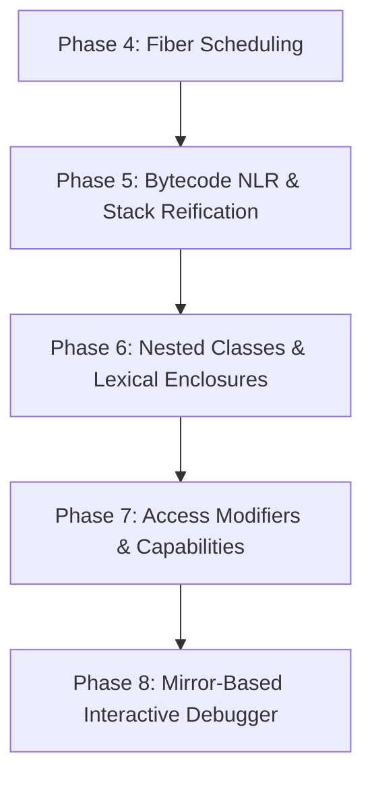

# Implementation Plan: Phases 5 - 8 Roadmap & Phase 5 Specification

> **⚠️ HISTORICAL (as of 2026-06-18) — superseded by `ROADMAP.md`.** This was the
> Phase-5 spec from an earlier era; most of its roadmap has since shipped. The
> canonical, current backlog is **`docs/ROADMAP.md`**. Phase status now:
> - **Phase 4 (Fiber Scheduling):** done at the VM level (cooperative
>   `fiberCreate`/`fiberSwitch`, state-by-vtable), but *dark* at the language
>   level — no `.ns` surface or test coverage (see `optimizations.md` snapshot
>   2026-06-18, "Fibers").
> - **Phase 5 (Bytecode NLR & Stack Reification):** done — `OP_NLR` (`vm.c:317`)
>   reifies the context and sends `#unwindTo:value:` (`vm.c:347`).
> - **Phase 6 (Nested Classes & Lexical Enclosures):** done — runtime BoundClass
>   model (conformance 47/0/1); spec `superpowers/specs/2026-06-18-nested-class-access-design.md`.
> - **Phase 7 (Access Modifiers):** partial — protected/private slot accessors
>   synthesised, but send-visibility is **not enforced** (no sender-frame check).
> - **Phase 8 (Mirror Debugger):** partial — low-level debugger primitives
>   (`singleStep:`, hook) exist; no Mirror hierarchy (see `reflection-mirrors-state`).
>
> Current top priority is **GP0 — GC / embedded memory** (Zephyr gate), not any
> phase below. The text below is retained verbatim for provenance only.

This plan establishes the strategic roadmap for Phases 5 through 8 of the OEVM micro-kernel, specifying the next immediate implementation steps for **Phase 5: Stack Reification & Bytecode-Driven Non-Local Returns (NLR)**.

---

## The Roadmap: Phases 5 - 8



* **Phase 5 (Next): Stack Reification & Bytecode-Driven NLR**
  - Shift stack walking and resource cleanup from a hardcoded C primitive to pure guest bytecode on `MethodContext`.
* **Phase 6: Nested Classes & Lexical Enclosures**
  - Implement outer-scope object traversal to support Newspeak's global-free class nesting.
* **Phase 7: Access Modifiers & Capabilities**
  - Validate and enforce method access boundaries dynamically using sender frame inspection.
* **Phase 8: Mirror-Based Interactive Debugger**
  - Implement breakpoints, VM step control, and live bytecode/vtable mutation.

---

## Phase 5 Technical Solutions & Architecture

Currently, stack unwinding is implemented inside a C-level helper function `primitive_unwind_to_value`. To achieve Piumarta's vision of architectural purity, we will transition the unwinding logic to **guest bytecode** executed directly on promoted `MethodContext` objects.

### 1. Stack Reification / Promotion
When a closure executes a return instruction targeting a lexical home context higher than its immediate caller:
* The VM intercepts this return (`OP_NLR`).
* The VM reifies the active context by setting its vtable pointer to `MethodContextVtable`.
* The VM then dispatches the late-bound Newspeak message:
  `send(current_frame, #unwindTo:value:, closure->home_ctx, return_val)`

### 2. Bytecode-Driven Unwinding
We will compile and solidify `MethodContextVtable >> unwindTo:targetHome value:rVal` directly into the boot Flash image:
```smalltalk
MethodContext >> unwindTo: targetHome value: rVal [
    (this == targetHome) ifTrue: [
        this executeCleanup.
        (this sender) resumeWith: rVal.
        ^ nil.
    ].
    this executeCleanup.
    (this sender) unwindTo: targetHome value: rVal.
]
```
* **`executeCleanup`**: A reflection primitive or bytecode helper that executes `cleanup_cl` if it is present.
* **`resumeWith:`**: A C-primitive that sets `current_frame` to the target context's sender, sets the return value, and exits the frame activation loop.

---

## Proposed Changes for Phase 5

### 1. VM Runtime
* #### [MODIFY] [vm.c](file:///home/david/workspace/oevm/src/vm.c)
  - Remove C-level recursive stack walking inside `primitive_unwind_to_value`.
  - Implement a simple `primitive_method_context_resume` C-primitive to handle the final context resumption stage.
  - Implement a bytecode helper or primitive for `executeCleanup` to trigger block cleans.

### 2. Solidification Pipeline
* #### [MODIFY] [tools/solidify.py](file:///home/david/workspace/oevm/tools/solidify.py)
  - Compile the `unwindTo:value:` bytecode method and associate it with the static `MethodContextVtable` in the generated Flash ROM image (`src/solidified_image.c`).

### 3. Verification
* #### [NEW] [tests/test_nlr.c](file:///home/david/workspace/oevm/tests/test_nlr.c)
  - Verify deep lexical unwinding across multiple frames, demonstrating that cleanup closures are run sequentially, and execution resumes at the proper caller site with the correct return value.
