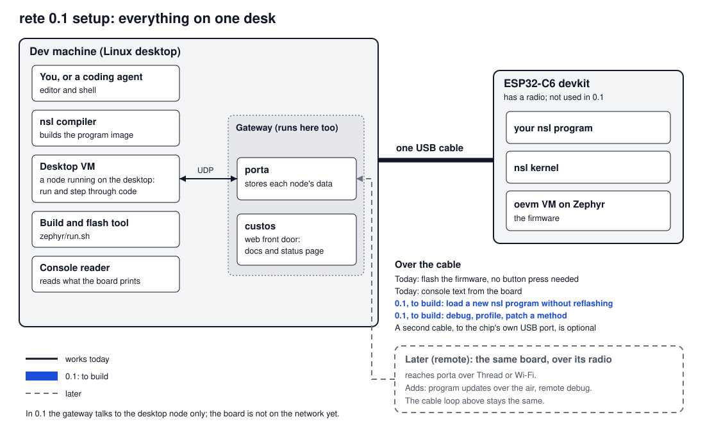

# rete — the whole on one page

**Written 2026-10-02. This page is a hub: it owns no facts, only links. Where it and a linked document disagree, the linked document is right and this page is stale.**

rete is an embedded fleet system in one repository. Small devices (**nodes**) run a small virtual machine and a small language; a **gateway** keeps a copy of what each node knows and hands each node what the operator wants. The two halves share one written contract and no code.

## The road to release

Decided by David, 2026-10-02 (recorded on rete#253 and rete#79):

- **The first public release is a 0.x — explicitly unstable, anything may change. The freeze is a later 1.0.0.**
- **0.1 is one person's first hour, on one board, on one USB cable.** A nascent system with a buildmap, not a finished one. The board is the ESP32-C6 devkit (first chosen as the RP2350, changed the same day: the C6 flashes without a button press, can save to its own flash, and has the radio the remote stage needs).
- **0.1 is portable by processor, with restrictions stated (David, 2026-10-06).** nsl must not read as an Espressif-only system: Zephyr was chosen for its driver breadth and its Thread support. The first hour is built and checked on the C6. The same VM, compiler and kernel run on the other processors below, each with what it cannot do yet:

  | Target | Processor | In 0.1 |
  |---|---|---|
  | Linux desktop | x86-64 (the host VM; a 32-bit build is gated by `portability-32`) | first-hour steps 1, 2, 8 and 9 |
  | ESP32-C6 devkit | RISC-V (Espressif) | the whole first hour |
  | nRF52840 DK and dongle | Arm Cortex-M4 (Nordic) | runs nsl, joins the Thread mesh, mirrored by porta. No program region, so no `load`: a change is a reflash (J-Link on the DK, DFU on the dongle). The dongle's USB console dies under the radio |
  | RP2350 (Pico 2 family) | Arm Cortex-M33 (Raspberry Pi) | runs nsl; 11.13 µs per activation against the C6's 11.83. Zephyr 4.2 has no flash driver for it, so no `load`, no saved settings and no boot count; flashing needs the BOOTSEL button; no radio |

  Sources: [BOARD_PORTS.md](../nodus/oevm/zephyr/docs/BOARD_PORTS.md), [the RP2350 numbers](results/2026-10-01-rp2350-first-numbers.md).
- **The step forward must be visible in 0.1:** debugging, profiling and patching a running method, on the device.
- **Remote comes later and adds to the local loop.** Updates over the air and remote debugging go through the gateway; the cable loop stays as it is.

### The first hour

| # | Step | State today |
|--:|---|---|
| 1 | Clone, build, run ten lines of nsl on the desktop | Works: [tutorial 1](tutorials/01-host.md), executed by the suite |
| 2 | Step through them in the debugger, on the desktop | Works: by file and line, as a page at `/debug` and an agent path over HTTP (#340, #362), executed by the suite ([tutorial 4](tutorials/04-debugger.md)) |
| 3 | Flash the C6 over the cable | Works, with no button press: the board harness does it unattended ([tutorial 2](tutorials/02-board.md)) |
| 4 | Read what the board prints | Works, over the same cable |
| 5 | Change the program and load it without reflashing the firmware | Done on the C6 (#310); over HTTP, `POST /load` and a page (#367) |
| 6 | Profile the program on the board | Works: a page at `/profile` and an agent path, its cost measured (#312, #364) |
| 7 | Debug on the board, over the cable | Works with a debug image, held state respected by the watchdog (#311); the standard image leaves the checks out |
| 8 | Stop, patch a method, restart it, resume | The desktop spike passes, in debug builds, for a method using only what the image holds ([result](results/2026-10-06-313-patch-restart-spike.md)); the board needs the patch sent over the cable (#313) |
| 9 | See the gateway mirror a node | Works with the desktop node: [tutorial 3](tutorials/03-porta.md). The board joins it in the remote stage |

The hour as one page, with the commands: [quickstart.md](quickstart.md). What it does not protect against: [limits.md](limits.md). Details and sources for steps 2 to 8 are in [development.md](development.md).

### The 0.1 buildmap

In dependency order.

1. Close the node-identity work in flight (rete#118, rete#242): see [FOCUS.md](../FOCUS.md).
2. (rete#310) The nsl program in its own region of flash, written over the cable by the flash tool, so a change does not reflash the firmware. This is the storage the remote stage's over-the-air update writes to later.
3. (rete#311) A debuggable C6 build over the cable, with a "held" state the watchdog respects.
4. (rete#312) Profiling as a command and a page, with its cost measured on a real program and stated.
5. (rete#313) Stop, patch, restart, resume: a spike on the desktop, then on the board.
6. (rete#314) One surface for the loop, so the tool enforces what are conventions today. The surface is custos's HTTP; the CLI is shelved (David, 2026-10-06; peer design D12).
7. The front door: a quickstart that is the first hour, a `LICENSE` at the repo root, one honest page (what is unstable, what is unauthenticated), and a check that no key or private hostname is in the git history.

**Rule:** steps 5, 7 and 8 of the first hour are spike-gated. One that passes its spike ships in 0.1; one that does not moves to the next release, and 0.1 says so plainly.

### What to know about the C6

From [BOARD_PORTS.md](../nodus/oevm/zephyr/docs/BOARD_PORTS.md) and [tutorial 2](tutorials/02-board.md):

| Point | Consequence |
|---|---|
| Heap | A ceiling of about 319 KB with the radio out of the build; the RP2350 has about 442 KB. Enough for a first hour; not the largest |
| Two USB ports | One cable to the devkit's USB-UART bridge does flash and console. The second port, the chip's own, is free and is a candidate for a separate debug channel |
| Zephyr | The Thread radio needs four driver fixes carried on a branch (`oevm-c6-radio-fix`). That matters for the remote stage. Whether a stock Zephyr is enough for the cable-only loop is not verified |
| The ship's bell | One C6 on this bench drives a physical bell; the scripts refuse to flash it |

The RP2350 stays a supported board (it is cabot's target), with three limits recorded in the same document: flashing needs a button held, the Zephyr version in use cannot save to its flash, and it has no radio.

### After 0.1

| Stage | What it adds | State |
|---|---|---|
| **Remote** | The same board reaches the gateway over its radio: nsl program updates over the air (not the firmware), remote debug and profile | Updates proven on the desktop only (rete#233); see [development.md](development.md) |
| **1.0.0** — the freeze | The surface enumerated, pinned and versioned; protection by level | Drafts: [the frozen surface](design/2026-10-02-frozen-1.0-surface.md), [security levels](design/2026-10-02-security-levels-design.md) |
| **Later** | Gateways serving several versions, gateways talking to gateways, cellular, Meshtastic | Sketched: [federation and transports](design/2026-09-14-porta-federation-and-transports-design.md) |

**What can be ignored until 0.1 is out:** everything in this last table. Those documents exist so the thinking is not lost, not because they block anything.

## The pieces

| Piece | In one line | Start here |
|---|---|---|
| **nodus** — the device end | A register virtual machine in C (`oevm`) running `nsl`, a small Smalltalk-family language; programs are compiled on a desktop and pushed to the device. | [vm.md](../nodus/oevm/docs/vm.md), then [programming_with_nsl.md](../nodus/nsl/docs/programming_with_nsl.md) |
| **porta** — the gateway | A Go program that mirrors each node's data, stores it, and holds what the operator wants each node to do. | [ARCHITECTURE.md](../porta/docs/ARCHITECTURE.md), [GETTING-STARTED.md](../porta/docs/GETTING-STARTED.md) |
| **custos** — the front door | A separate small program in front of porta, for browsers and agents: it serves these documents and the status page and passes through porta's health and manifest routes. Formerly "gatekeeper". | [ARCHITECTURE.md](../porta/docs/ARCHITECTURE.md), [the first-cut design](../porta/docs/design/2026-08-22-gatekeeper-first-cut-design.md) |
| **Communications** — the wire | What a node and its gateway say to each other, and over which radios. | [PROTOCOL-NSL.md](../protocol/PROTOCOL-NSL.md), [the record catalogue](../protocol/PROTOCOL-NSL-RECORDS.md), [MANIFEST.cddl](../protocol/MANIFEST.cddl); radios in [federation and transports](design/2026-09-14-porta-federation-and-transports-design.md) §3 |
| **Security** | Who may talk to whom, by level of node. | [security levels](design/2026-10-02-security-levels-design.md) (draft) |
| **The surface and its versions** | What an outside user may depend on, and how it is numbered. | [the frozen surface](design/2026-10-02-frozen-1.0-surface.md) (draft) |
| **Goals** | Why this exists and where it is going. | [WHY.md](../review/WHY.md), [WHY-AGENTS.md](../review/WHY-AGENTS.md), [WHY-OEOM.md](../review/WHY-OEOM.md); the ladder in [program-sequence.md](../review/program-sequence.md); [next-steps-overview.md](next-steps-overview.md) |
| **Development** | Agent-first, and measured. David: "agents can't smell" — an agent has no feeling that something is off, so a claim counts only when a test or a measurement shows it. | [development.md](development.md) (the loop: code, flash, observe, debug, profile, update), [CLAUDE.md](../CLAUDE.md) (the gates and standing rules), [the claims ledger](../review/tests/CLAIMS.md), [WHY-AGENTS.md](../review/WHY-AGENTS.md) |
| **Where things stand today** | The current focus and the open work. | [FOCUS.md](../FOCUS.md), the pinned tracker rete#26, [the docs map](README.md) |

## Gaps this page exposes

| Gap | Today |
|---|---|
| Development is written but not executed | [development.md](development.md) is prose from what exists; no gate runs it, and debug has no start-here command |
| The radios have no mainline document | They live only in a dated design record |
| custos has no document of its own | A section of porta's architecture page and two dated designs |
| The honest status page for 0.1 | Not written |
