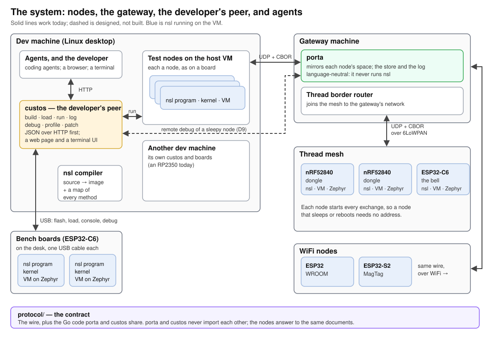
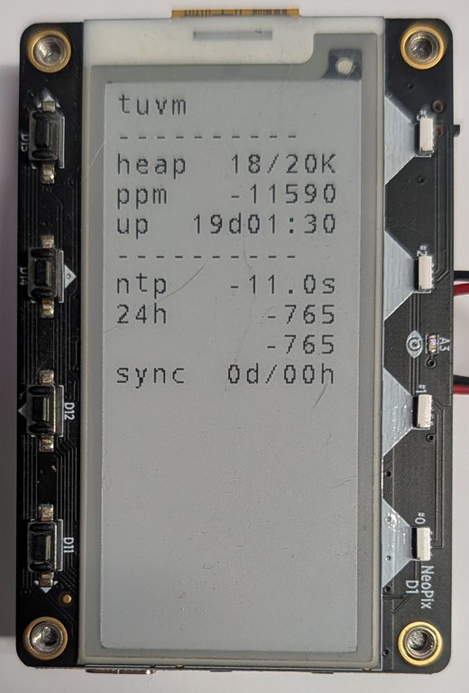
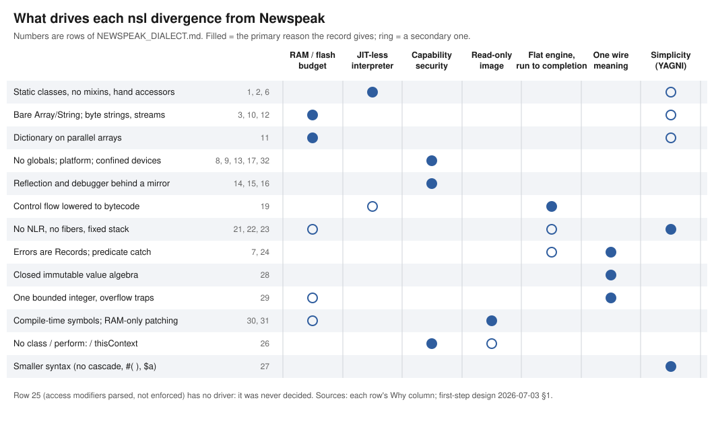
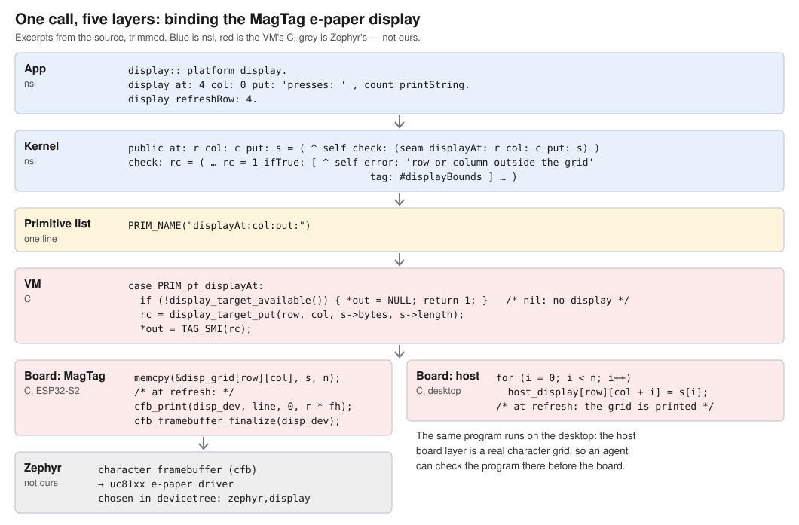

# nsl: a Newspeak dialect for Zephyr — what it keeps, what it drops, and why

**and the case for an agent-first OO language**

_DRAFT 2, 2026-10-07, for iteration with David. Sources are bracketed keys, e.g. [VM], resolved in the
References; in this Markdown they are links. The PDF beside this file is rendered from it._

## Abstract

Embedded VMs used to live or die by porting: many RTOSes, each with its own drivers, network stack and security
story, and a VM had to follow them all. Zephyr's reach changes that: a VM ported once can reach more than 900
boards, with connectivity, security and drivers built in — Thread among them, more work than a small project could
build alone. Zephyr's cost is the learning curve, which its own community names its most persistent challenge
[ZT10].

nsl is a Newspeak dialect that puts an approachable object-capability language over Zephyr. Zephyr carries the
freight, nsl directs traffic: the radio, the crypto and the drivers stay in C, and the interpreter pays mostly for
decisions. A host compiler produces a read-only image that a small C VM runs in place from flash, in the roughly
112 KB that Zephyr, OpenThread and mbedTLS leave on a 256 KB nRF52840. nsl keeps Newspeak's structure — modules as
objects, no globals, capabilities as the unit of authority — and drops most of its dynamism, each drop with its
reason and its cost.

Last, the case for an agent-first OO language. Agents can't smell trouble, but they can find patterns in data, so
every tool answers in data: the whole language fits in a context window, every development verb is a
machine-readable HTTP call, every profile sample or crash names a source line, and the loop is short — the host VM
first, then a device load, not a reflash. Zephyr's contributors don't trust AI-generated code without heavy review
[ZT10]; nsl bets that a fast, repeatable loop supplements that review.

## The system at a glance



_Figure 1. Field nodes (A′, B′) run commissioned images and reach the gateway over Thread or WiFi; porta mirrors
each node's state and keeps the images it commissioned. Each developer works on a twin on the desk (A, B) over one
USB cable, and on test nodes running on the desktop's VM, through custos — the same HTTP calls whether a person or an
agent makes them. A and A′ drift apart while a bug is chased on both, which is why porta, not the developer's
machine, is to be the custodian of what runs in the field (decided; the commissioning step is not yet built). Reaching a field node's debugger through porta is designed,
not built. porta and custos share only the contract in `protocol/` [Porta], [Peer]._

## 1. The constraints

nsl's floor is a 256 KB-RAM microcontroller with a radio. That is a hard target but not an extreme one: it is about
as small as a part can be and still hold Zephyr, a Thread stack and an application, and it covers common radio parts,
the nRF52840 and the ESP32-C6 among them. Smaller parts are not a goal. Size was the target, but simplicity was the
mechanism: the July 2026 rewrite removed non-local return, fibers and growable stacks because they had become "a
cascade of interacting complexity … with the VM ballooning far past its simple intent" [Pivot], and the bytes it
saved were modest — 3 921 B of code, 676 B of RAM [MA]. Most of the choices in §4 would hold on a large board too
(Figure 3).

**What 256 KB leaves.** Measured from the linker symbols of the nRF52840 dongle's Thread build (2026-10-03):

| Use | RAM |
|---|---:|
| VM arena: objects, the VM's own 16 KB stack, floats | 112 KB |
| Zephyr kernel, drivers, USB, thread stacks | 57 KB |
| Zephyr system heap | 32 KB |
| OpenThread and the 802.15.4 radio driver | 25 KB |
| Network buffers | 14 KB |
| mbedTLS | 10 KB |
| Spare | 4 KB |

Zephyr and its radio stack take about 140 KB and nsl gets the rest, with 4 KB to spare at link time. The VM's code is
not the tight axis — about 42 KB of a 1 MB flash. RAM is.

**The tightest arena is not on the smallest part.** Across the boards the VM runs on [Boards]:

| Board | RAM | VM arena | What sets it |
|---|---|---:|---|
| ESP32 (WROOM) | 520 KB, of which Zephyr maps ~192 KB as data RAM | 48 KB | WiFi's driver heap and TCP buffers take the rest |
| ESP32-S2 (MagTag) | 320 KB | 64 KB | WiFi; 92 KB links, 64 KB is what has booted |
| nRF52840 | 256 KB | 112 KB | Zephyr, OpenThread and mbedTLS; 4 KB spare |
| ESP32-C6 | 512 KB | 128 KB | a chosen default with margin; 256 KB links with the radio |

WiFi, not the size of the part, is what squeezes the classic ESP32 to 48 KB.

**An interpreter, with no JIT.** There is no room here for a JIT's code cache, so every method runs in the
interpreter. One method activation costs about 12 µs (11.83 on the C6, 11.13 on the RP2350 [RP2350]), roughly a
hundred times the same work in C. That is cheap at the rate events arrive — a timer, a packet, a button — and
expensive per byte, which is why the radio, the crypto and the drivers stay in C, and why code that turns out hot can
follow them (§2).

**A program that cannot be written at run time.** The program is a read-only image in its own flash partition,
executed in place [Image]. The firmware is flashed once; programs are loaded beside it.

**A peer that is not nsl.** A gateway written in Go mirrors each node's state over UDP and CBOR, so the wire format is
a contract between two languages, not an nsl object serialisation [Porta].

## 2. The VM

oevm is a register VM in C, built on Piumarta and Warth's Open Extensible Object Model [OEOM]: object, symbol and
vtable are the only primitive kinds, and everything else — arithmetic included — is a message that a vtable answers.
Instructions are 32 bits and fixed length, 31 of them; small integers take a fast path and fall back to a send. One
instruction carries Newspeak's implicit-receiver send, which looks up a name in the lexically enclosing classes before
the superclasses. The interpreter is one flat, non-recursive loop over one fixed-capacity stack, and a context lives
on the heap so that a block can outlive the frame that made it — which is the whole reactive model (§3). Memory is a
fixed arena with a precise mark-sweep collector and no `malloc` once running [VM].

The kernel is nsl, not C: collections, the value algebra, the CBOR codec, channels, the space, timers, the supervisor
and the gateway bridge are all nsl source. C carries data, nsl carries policy.

**Binding a driver: no FFI, one primitive.** nsl code cannot call an arbitrary C function. A device is reached through
a *primitive*: a selector on a closed list, 160 of them today, each backed by one C function that calls the Zephyr
driver API. Binding a new driver means appending one name to that list, writing the C function, and adding the
kernel method that hands the device out — through `platform` — as a capability. The change is additive: nothing
already on the list moves, and no app can add a primitive of its own [Serial]. The firmware's author extends the
machine; the program only uses what it was given.

**`platform` is a capability, not a namespace.** nsl follows the object-capability rule: authority is holding a
reference, and there is no ambient authority to fall back on. A program's `main:` is handed one object, `platform`,
and everything it can name — library classes, devices, the space — it reaches through objects it was handed.
That is why a program writes `platform space`, `platform timers` and `platform Record`: there is no other way to
reach them. A
module given only `net` can use the network and nothing else, and says so in its header. Today `platform` is one
object that hands out every device and library class (ledger row 32). That is a convenience of the first release,
not part of the design: since `platform` is only an object, a narrower one can be handed down — a module that
receives only the display cannot touch the radio. For the same reason, a different `platform` could carry
different implementations: collections tuned for size rather than speed, say, or a simulated device in place of a
real one, without a line of the program changing. The language allows this; version 0.1 does not use it, and has
one kernel.

Appendix B follows one call through every layer, for the e-paper display on Adafruit's MagTag (ESP32-S2); Figure
2 shows those primitives in service.

<p align="center"></p>

_Figure 2. The same primitives in service: an nsl clock node on a MagTag, 19 days up, showing its heap, its
measured clock drift and its last NTP check. Photographed under the project's previous name, `tuvm` [Clock]._

**Native code replaces nsl code without anyone noticing.** Because every operation is a send through a vtable, a
method is a binding from a selector to a closure, and whether that closure is interpreted or native is one field. To
move a hot method to C, write the C and bind it: the callers, the interpreter and the image format do not change. A
spike did this for the Towers of Hanoi on an ESP32, and the native method ran 116–119 times faster than the
interpreted one at two problem sizes [Hanoi]. That is a best-case ceiling — all the work in one method, the recursion
fully native — not a steady-state figure for a whole program. The point is the mechanism: a VM that dispatches on
type tags would need a special case on every call path; this one needs one binding.

## 3. A reactor, not threads

Zephyr is multithreaded; nsl is not. The VM runs on one Zephyr thread, and the C side — OpenThread, the network
stack, the liveness observer — runs in threads around it. Inside nsl there is one reaction at a time, and each runs
to completion.

State lives in a **space**, nsl's descendant of the tuple spaces of Linda, simplified: a value is found by its
name, not by matching its contents. The names are paths, and a node is programmed against names, not addresses. The
Thread node in Appendix A uses five:

| Path | Kind | Who writes it | Who reads it |
|---|---|---|---|
| `goal/name` | cell | the gateway, as intent | the node, which reacts |
| `obs/name` | cell | the node, as its answer | the gateway |
| `tel/log` | stream | the node, a row per tick | the gateway, every row |
| `sys/timer` | stream | timer interrupts | the timers' dispatcher |
| `sys/tick` | stream | the node's own timer | the node's `tick` |

A *cell* holds the latest value; a *stream* is append-only. Every path that crosses the wire has its kind and its
record shape declared once, in the protocol's manifest, and the gateway refuses a write that disagrees [Manifest].
Paths under `sys/` stay on the node. A program
registers a reaction with `whenever:do:`; a write to a path queues the reactions that care, and the reactor runs
them one by one. Timers post from their interrupt to a mailbox, and the reactor blocks on it when there is nothing to
do [VM]. The gateway sees the same names: porta mirrors parts of each node's space, so `goal/name` written at the
gateway arrives as a write in the node's space, and no part of the program knows which side of the radio a value came
from.

Why not threads, the usual answer on an RTOS:

- **No locks and no data races in nsl code.** A reaction cannot be interrupted by another, so shared state needs no
  protection and an agent writing a reaction cannot get it wrong.
- **RAM is predictable.** Threads cost a stack each, sized for the worst case. The reactor has one stack, and the
  rewrite that removed fibers removed their per-fiber stacks with them [MA].
- **Errors are contained, not fatal.** A reaction that fails is caught by the supervisor, which keeps the heap and the
  reactor running and restarts or quarantines the job [MD].

The cost is the one every event loop has: a long computation starves the timers. The answer is to split it across
reactions, and the guard is the **liveness observer**, a C thread that judges the reactor's progress against the
shortest timer period the program has declared. A wedged node is dumped, rebooted, and leaves a note saying why
[Liveness].

**Always-on and deep sleep.** A node's power mode is a value at a path, written by the gateway and acknowledged by
the node — not a command [Porta]. An *always-on* node runs a loop that never returns; it is the mains profile. A
*deep-sleep* node wakes, takes its reading, exchanges with the gateway and sleeps again; `platform deepSleep:` never
returns, and the next wake is a full reboot. Its program is declared *run-once*, because a loop that expected to keep
running would be killed by each sleep. Deep sleep runs on the MagTag today. What makes it work is that every exchange
is started by the node: a sleeping node has no address to be called on, so the gateway holds what it wants — a new
setting, a new program — until the node next wakes and asks.

## 4. The dialect against Newspeak



_Figure 3. Each group of divergences from Newspeak against the reason its record gives. Numbers are rows of the
dialect ledger [Ledger]._

### 4.1 Kept

- **No global namespace.** Every name is reached through an object handed in: `platform List`, `platform space`. A
  class that was not given `platform` cannot reach the library at all (ledger rows 8, 9).
- **Modules are objects.** `class App packageUsing: manifest = (…) ( public main: platform args: args = (…) )`; the
  module is an instance parameterised by what it was given.
- **Nested classes and implicit-receiver sends**, with Newspeak's lookup order (lexical first), so an upgraded
  superclass cannot capture a name the enclosing module defines.
- **Slots with `::=` (mutable) and `=` (immutable), `::` assignment, keyword selectors, blocks, class-side bodies.**

### 4.2 Changed or removed

| Area | Newspeak | nsl | Primary driver |
|---|---|---|---|
| Class references | virtual (late-bound slots) | static, resolved at compile time (row 1) | no JIT: production Newspeak makes virtual lookup free on Truffle/Graal |
| Composition | mixin application | single inheritance, one `delegate` (row 2) | as above; mixins are how virtual classes compose |
| Non-local return | `^` from any block unwinds to its home | compile error from an escaping closure (row 21) | simplicity: non-local return forced the reify/unwind/cross-fiber cascade |
| Concurrency | actors / processes | a run-to-completion reactor over a tuple space (row 22) | the same rewrite; determinism, predictable RAM |
| Exceptions | class hierarchy, resumable | `Record {#tag,#text}` values, predicate `on:do:`, `ensure:`, terminate-only (row 24) | errors cross a channel and the wire, so they must be values |
| Reflection | ambient | a `mirror` capability held only by the supervisor (rows 15, 16); no `class`, `perform:`, `thisContext` (row 26) | capability security; a closed-world image |
| Integers | unbounded | one type, ±(2^64−1), overflow traps (row 29) | one range for host, board and CBOR |
| Strings | collections of characters | immutable UTF-8 bytes, no `Character` (row 10) | one allocation, a GC leaf |
| Symbols | interned at run time | interned at compile time only (row 30) | the image is read-only |
| Methods | recompiled in place | read-only image; a debug build can override a method from RAM and restart its frame (row 31) | the image lives in flash |
| Syntax | cascades, literal arrays, `$a`, radix numbers | a 109-line grammar without them (row 27) | simplicity |
| Access modifiers | enforced | parsed, not enforced (row 25) | **undecided** — a finding of the 2026-10-06 audit |

### 4.3 Why most of this is reversible

The structural half (no globals, modules as objects, confined privilege) was paid for first because it cannot be
retrofitted, and most subtractions are additive to restore: static binding is the special case of late binding in
which no class slot is overridden, so nothing written for nsl becomes wrong if virtual classes come back. The
exceptions are rows 21–24: restoring non-local return, processes or resumption would bring back the machinery the
rewrite deleted, and they are not on any plan.

## 5. Against Smalltalk-80 and Pharo

nsl's ancestry runs through Smalltalk — this system has been rewritten wholesale four times on the way here — and a
Smalltalk programmer reads it easily. The differences are mostly about *where authority and state live*, not about
expression.

| | Smalltalk-80 / Pharo | nsl |
|---|---|---|
| Everything is an object; computation is message sends | yes | yes — including arithmetic, which falls back to a send off the integer fast path |
| Keyword selectors, blocks as closures | yes | yes |
| Control flow | `ifTrue:` etc. are messages, inlined by the compiler | the same, and the inlining is now the only implementation (row 19) |
| Namespace | one global `Smalltalk` dictionary; any method names any class | none; everything through `platform` (rows 8, 9) |
| The image | a live, mutable heap you develop in and ship | a frozen image built from source; the VM runs it from flash |
| `thisContext`, `become:`, `perform:`, `instVarAt:` | yes, ambient | no; frame access only through the confined mirror (rows 15, 26) |
| Processes and semaphores | yes | no; reactions that run to completion (row 22) |
| Non-local return | yes | only from inlined blocks (row 21) |
| Exceptions | class-based, resumable | value-based, predicate-filtered, terminate-only (row 24) |
| Class extension (adding methods to `Object`) | yes, from any package | no; the kernel is one module, and an app cannot reach its classes to extend them |
| Debugging | in-image, by anyone | over a line protocol to the confined debugger, from a host (§6) |

What nsl takes from Newspeak rather than Smalltalk is the point of it: a module cannot reach anything it was not
given, and that is what makes a capability *mean* something. What it gives up relative to Smalltalk is liveness: the
system is developed on a host and deployed as an image, and hot patching is a debugging act, not the way programs
are built.

## 6. Debug, patch, profile — on the device

A small device usually means printf and a reflash. nsl's answer is a set of tools that reach into the running VM
over the device's one USB cable, through **custos**, the developer's peer on the host. Every tool is an HTTP call
that answers in JSON first, with a web page and a terminal front over the same calls [Peer].

| Tool | What it does today | Record |
|---|---|---|
| **load** | replaces the program without reflashing the firmware; the node reports the new program's hash (ESP32-C6) | [Image] |
| **debug** | breakpoints by source line; `step`, `next`, `finish`; the stack and named local variables at a stop | [Debugger] |
| **patch** | in a debug build, replaces one method of a program stopped at a breakpoint, restarts the frame, and continues into the new code — shown on an ESP32-C6 on 2026-10-06 | [Patch] |
| **profile** | per-method call counts from the standard image on the ESP32-C6, so a field node is profiled without a reflash; it costs 1.3 % on the worst-case benchmark | [Profile] |
| **log** | the node's log and console, collected by custos | [Peer] |

Every one of these names source, not addresses: the image map that ships beside each image gives every method's
file and line, so a breakpoint, a profile sample or a crash lands on a line a person or an agent can open [Image].

**Deep-sleep nodes — designed, not yet built.** The same tools are designed to reach a node that is asleep most of
the time, using the model §3 already gives: intent is a value the gateway holds. A breakpoint is written under the
node's goals; the gateway holds it until the node next wakes and asks, whether that is seconds or two hours away. On
a hit, the node reports the stop and stays awake while the debugger steps, and the liveness observer already knows
not to reset a node held at a breakpoint [Peer]. A profile request works the same way: the next wake runs under the
profiler and ships the counts [ProfileVerb]. Remote debugging of a sleepy node is the demonstration planned after
version 0.1; until it runs, this paragraph is a design, not a result.

## 7. The case for an agent-first OO language

The Zephyr community is already using AI to write code, and does not trust it. Of 125 contributors surveyed, 54 %
say it helps them write code faster — and 54 % say it gives unexpected or incorrect output they must fix frequently;
33 % spend more time validating its output than they would writing from scratch; 18 % say it helps them write code
with fewer errors; and 78 % do not trust its suggestions without heavy review ([ZT10], Figure 35).

The problem those numbers describe is verification, and an agent verifies by running things and reading what comes
back. So the platform is agent first: every custos verb has a machine-readable HTTP path before any human front
[Peer], and the language should be chosen on the same terms. The argument, with what is measured and what is not:

1. **Keyword selectors name every argument at the call site.** `aSocket sendTo: host port: p data: bytes` cannot be
   called with the port and the host swapped without the code saying so; `sendto(fd, buf, len, 0, addr, alen)` can.
   The selector is the documentation, and it is the part of the code an agent pattern-matches on. *Not measured*: we
   have no count of argument-order errors by agents in nsl versus C or Python.
2. **The whole language fits in a context window.** Measured 2026-10-06 (bytes; tokens estimated at 3.5 bytes per
   token, not counted by a tokenizer):

   | Piece | Bytes | ≈ tokens |
   |---|---:|---:|
   | Grammar (109 lines) | 3 416 | 1 000 |
   | User's guide [Guide] | 27 385 | 7 800 |
   | Dialect ledger [Ledger] | 36 374 | 10 400 |
   | Kernel's public selectors (438 signatures) | 6 397 | 1 800 |
   | Kernel source without comments | 91 815 | 26 200 |
   | Kernel source as written | 247 689 | 70 800 |

   Grammar, guide, ledger and the comment-free kernel come to about 160 KB, roughly 45 000 tokens: the complete
   language, standard library included, fits a 200 k window with room for the program, and the grammar plus guide plus
   public selectors fit easily in the 64 k window of a local model. A Python or C agent works from memory of a library
   it cannot see; an nsl agent can be given all of it.
3. **Authority is visible in signatures.** A module that can use the network says so in its header
   (`usingPlatform: platform net: net`); a channel capability can only narrow. An agent — or a reviewer of an agent's
   work — can read what a piece of code is able to touch without reading its body. (Weakened today: `platform` hands
   out every device; see §8.)
4. **A small, closed primitive set.** 160 primitives, all other code is nsl; there is no FFI to wander into (§2).
5. **Errors written for a reader that is an agent.** A message not understood names the receiver's class and the
   nearest selector it does understand; about 1 KB of flash is spent on that on purpose, because "an operator that is
   an agent is exactly as good as the error line it is fed".
6. **Every artefact is addressable**, and every tool answers in data (§6).
7. **The loop is short.** A program runs first on the VM on the host, then is loaded onto the device without a
   reflash; a stopped method can be patched and resumed. A short loop makes each check cheap, and cheap checks are
   what the 33 % above are missing. *Not measured*: we have not timed the loop end to end.

**Against it, honestly.** Dynamic typing gives an agent nothing at compile time: a misspelt selector is found when it
runs, which is why item 5 exists. nsl is not in any model's training data, so an agent writes it from the context it
is given, not from habit — which is the bet item 2 makes and has not yet tested. What would test it: the same small
board tasks given to an agent in nsl (with the language in context) and in Zephyr C, scored on first-run correctness.
We will run that comparison and publish the result: shown, not told (rete issue #373).

## 8. Costs, and what would lift each

| Cost | Felt as | Would lift it | Ledger row |
|---|---|---|---|
| No virtual classes or mixins | a library cannot be specialised per target except by choosing a module at boot | restore late-bound class slots on the same vtable substrate | 1, 2, 6 |
| No non-local return | loops that would `^` out of a `do:` are rewritten as `detect:ifNone:` or a flag | not planned | 21 |
| No processes | a long computation starves timers | split it across reactions; the liveness observer shows the stall | 22 |
| No resumable exceptions | a handler cannot supply a value and continue at the raise | `on:do:` answering the default | 24 |
| Per-byte work is interpreted | the CBOR codec is nsl, and every byte it reads costs a method activation | move the hot methods to C by native substitution (§2) | — |
| `platform` is all-powerful | any app holds every device | narrowed platforms, or `serial:`/`net:`-style header grants for devices | 32 |
| Access modifiers unenforced | `private` documents intent and nothing more | emit them and check, or delete the check (#372) | 25 |
| Hot patch limited to known constants | a fix that names a new selector or string cannot be patched | intern in RAM; carry offsets in the image map | 30, 31 |
| No `Character`, byte strings | text is bytes | a rune-aware protocol | 10, 12 |

<div style="page-break-before: always"></div>

## Appendix A. A Thread node in 36 lines of code

A node that joins the gateway over Thread, checks in every two seconds, publishes a log line each time, and answers
a name the gateway gives it. Thread itself is attached by the firmware before the VM starts; the program sees an IPv6
UDP socket. It compiles for the nRF52840; it is cut down from the bench's porta node, which runs, and has not itself
been run [Example].

```
(* The header is the program's authority: the platform and the network, nothing else. *)
class ThreadSensorNode usingPlatform: platform net: net = (
  | space bridge timers ticks ::= 0. |
) (
  gwAddr  = ( ^ 'fdc5:9109:9afe:97ea:9541:d963:f8d9:8567' )   (* the gateway, mesh-local *)
  gwPort  = ( ^ 6969 )
  cadence = ( ^ 2000 )                                         (* ms between check-ins *)

  public main: platform2 args: args = (
    | sock tickChan |

    (* The space: this node's state, kept under path names rather than addresses. *)
    space:: platform space.

    (* The bridge mirrors parts of the space to porta: it pulls what porta wants
       (goal/...) and pushes what the node reports (obs/..., tel/...). *)
    sock:: net udpBindPort: 16970.
    sock == nil ifTrue: [ 'bind failed' println. ^ 1 ].
    bridge:: platform PortaBridge
      socket: sock space: space id: platform nodeId peer: self gwAddr port: self gwPort
      spans: platform Spans new.
    bridge subscribeStream: 'tel/log'.               (* push every row of this stream *)
    bridge liveness: self cadence misses: 16.        (* tell porta when to call us silent *)
    bridge publishBuild: #nrf52840.

    (* porta writes a name at goal/name; the node answers at obs/name. *)
    (space channel: 'goal/name') whenever: '' do: [ :v | space put: 'obs/name' value: v ].

    (* Timers, like everything else, come from the platform. Their interrupts post to
       sys/timer; one reaction hands each to the timer that owns it. *)
    timers:: platform timers.
    space whenever: 'sys/timer' do: [ :e | timers dispatch: e ].
    tickChan:: space channel: 'sys/tick'.
    tickChan whenever: '' do: [ :m | self tick ].
    bridge startTicking: timers on: tickChan.        (* one tick per cadence *)

    (* The reactor: wait for an event, run the reactions it queued, repeat. *)
    [ true ] whileTrue: [ platform pumpEvents. space drain ].
    ^ 0
  )

  (* Each tick: exchange with porta, then add one row to the log stream. *)
  tick = (
    ticks:: ticks + 1.
    bridge checkIn.
    space out: 'tel/log' value: (platform Record tag: #Log
      with: #lvl -> #info with: #txt -> ('tick ' , ticks printString)).
    ^ self
  )
) : (
  public packageUsing: manifest = ( ^ self new )
)
```

The node never names an address inside the program except the gateway's. Everything else is a path in its space:
porta writes `goal/name` and reads `obs/name` and `tel/log` at the node's next check-in, and the timers reach the
program at `sys/timer` and `sys/tick` the same way (§3).

<div style="page-break-before: always"></div>

## Appendix B. Binding a driver: one call, five layers



_Figure 4. `display at: 4 col: 0 put: …` from the app down to the panel. The driver is Zephyr's (its character
framebuffer and the uc81xx e-paper driver); what nsl adds is glue: a 13-line kernel class, four primitives, and
the C that hands their arguments to Zephyr. The host has its own board layer, a real character grid, so the same program can be run and checked on
the desktop before it reaches the board [Display]._

<div style="page-break-before: always"></div>

## References

- **[ZT10]** B. Trinkenreich, A. Lawson and H. Carter, *Zephyr Turns 10: A Decade of Adoption, Maturity, and Ecosystem
  Evolution*, The Linux Foundation, March 2026, CC BY-ND 4.0 —
  [copy in this repository](../../../docs/ZephyrTurns10_Report_Revised_051826.pdf). 900+ boards; the learning curve;
  Figure 35 (p. 30), GenAI.
- **[OEOM]** I. Piumarta and A. Warth, *Open, Extensible Object Models* (2007).
- G. Bracha et al., *Modules as Objects in Newspeak* (ECOOP 2010); G. Bracha and D. Ungar, *Mirrors: Design
  Principles for Meta-level Facilities of Object-Oriented Programming Languages* (OOPSLA 2004); A. Goldberg and D.
  Robson, *Smalltalk-80: The Language and its Implementation* (1983).
- **[Ledger]** [The nsl dialect ledger](NEWSPEAK_DIALECT.md): every divergence from Newspeak, its reason and what
  would revisit it (rows 1–32, audited 2026-10-06).
- **[Guide]** [Programming with nsl](programming_with_nsl.md), the user's guide.
- **[VM]** [oevm — what the VM is](../../oevm/docs/vm.md).
- **[Pivot]** [The July 2026 rewrite's design](design/2026-07-03-nsl-tuvm-first-step-design.md): no
  non-local return, no fibers, the reactor; the 256 KB target.
- **[MA]**, **[MD]** [Milestone A](../../oevm/docs/MILESTONE_A.md) (what the rewrite deleted, measured) and
  [Milestone D](../../oevm/docs/MILESTONE_D.md) (the supervisor).
- **[Boards]** The board profiles in [`run.sh`](../../oevm/zephyr/run.sh) and
  [the board ports](../../oevm/zephyr/docs/BOARD_PORTS.md); the nRF52840 RAM split from that build's linker symbols.
- **[RP2350]** [First numbers on the RP2350](../../../docs/results/2026-10-01-rp2350-first-numbers.md).
- **[Image]** [The image and its map](../../../protocol/IMAGE-ARTIFACTS.md).
- **[Porta]** [porta's architecture](../../../porta/docs/ARCHITECTURE.md), §5: power modes and app lifecycle.
- **[Serial]** [Adding the serial device](design/2026-06-22-ns-oevm-stdlib-step3c3b-serial-design.md): a device
  target is purely additive.
- **[Hanoi]** [Native substitution, the Hanoi spike](../../../docs/design/2026-07-17-oeom-native-substitution-hanoi-spike-design.md).
- **[Liveness]** [The liveness observer](../../../docs/design/2026-08-16-vm-liveness-observer-design.md).
- **[Peer]** [custos, the developer's peer](../../../docs/design/2026-10-04-custos-peer-design.md): agent first
  (D11–D13), remote debugging of a sleepy node (D9).
- **[Debugger]** [Tutorial 4, the debugger](../../../docs/tutorials/04-debugger.md).
- **[Patch]** [Stop, patch, restart, resume](../../../docs/results/2026-10-06-313-patch-restart-spike.md).
- **[Profile]** [Profiling over USB](../../../docs/design/2026-10-05-custos-profile-over-usb.md).
- **[ProfileVerb]** [The profile verb](../../../porta/docs/design/2026-06-26-profile-verb-design.md): profiling a
  deep-sleep node on its next wake.
- **[Example]** [`ThreadSensorNode.nsl`](examples/ThreadSensorNode.nsl), cut down from
  [`PortaBridgeNodeNrf.nsl`](../../oevm/zephyr/PortaBridgeNodeNrf.nsl).
- **[Display]** [The MagTag e-paper display design](../../../docs/design/2026-07-23-magtag-epaper-display-seam-design.md)
  and [`MagTagDisplayNode.nsl`](../../oevm/zephyr/MagTagDisplayNode.nsl), the program Figure 4 quotes.
- **[Clock]** [`MagTagClockNode.nsl`](../../oevm/zephyr/MagTagClockNode.nsl), the program in Figure 2.
- **[Manifest]** [`MANIFEST.cddl`](../../../protocol/MANIFEST.cddl), the normative catalogue of paths, kinds and
  shapes, and [its design](../../../docs/design/2026-08-24-kind-schema-manifest-design.md).
