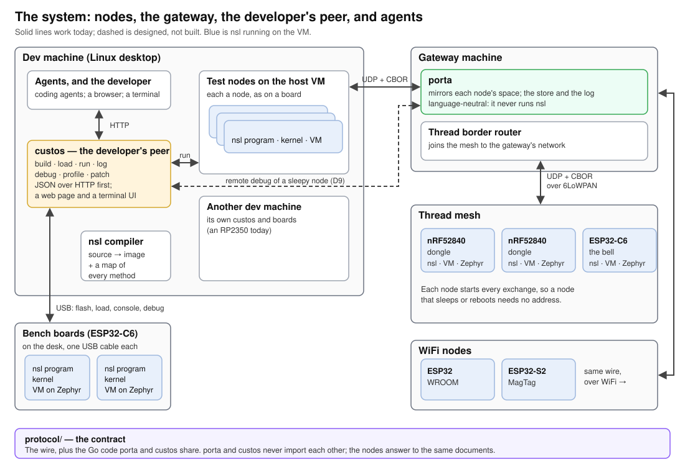
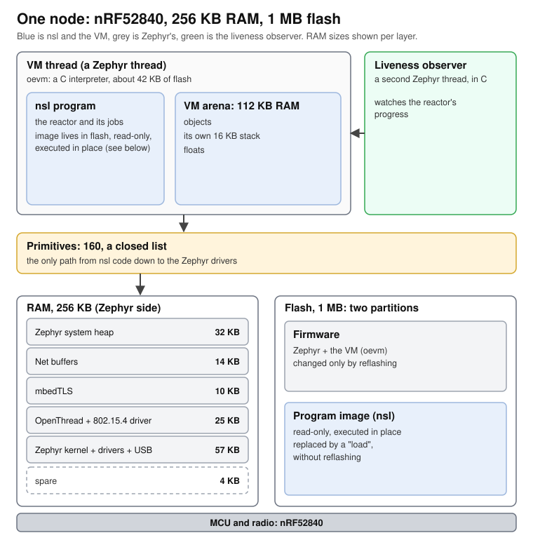
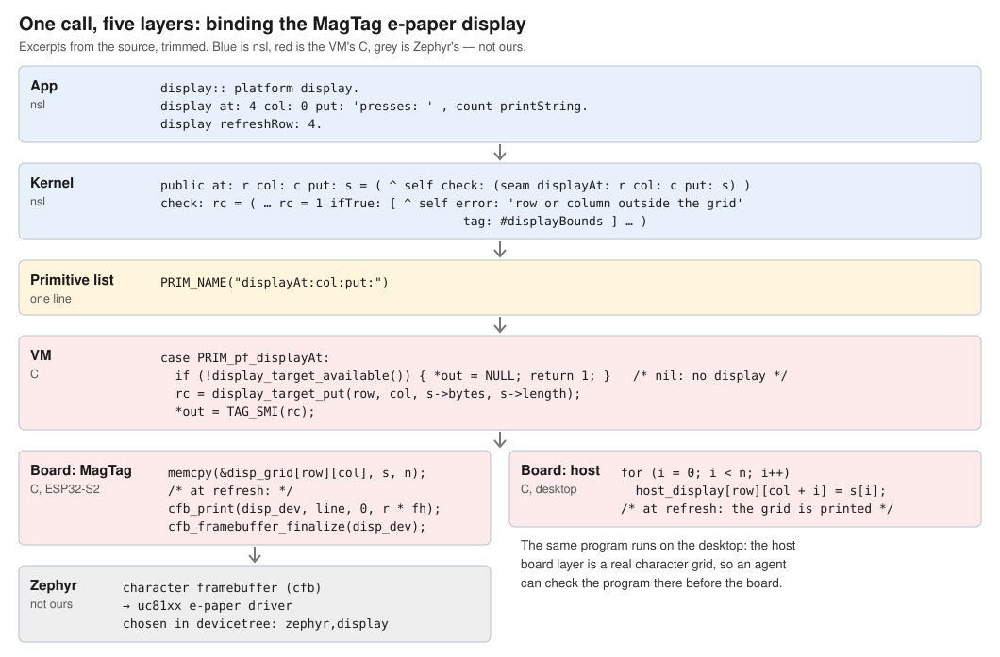
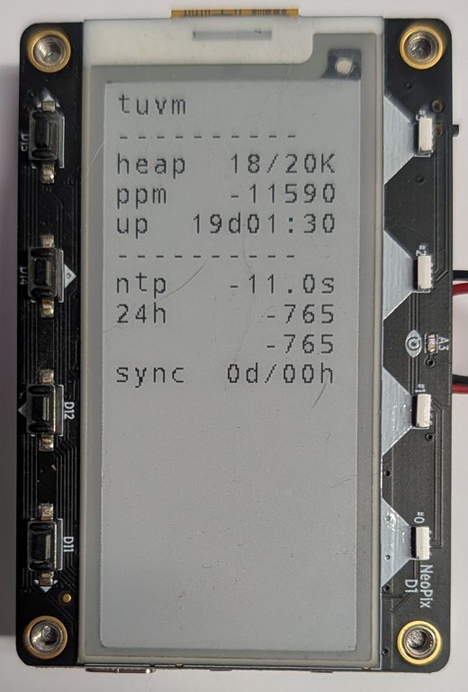
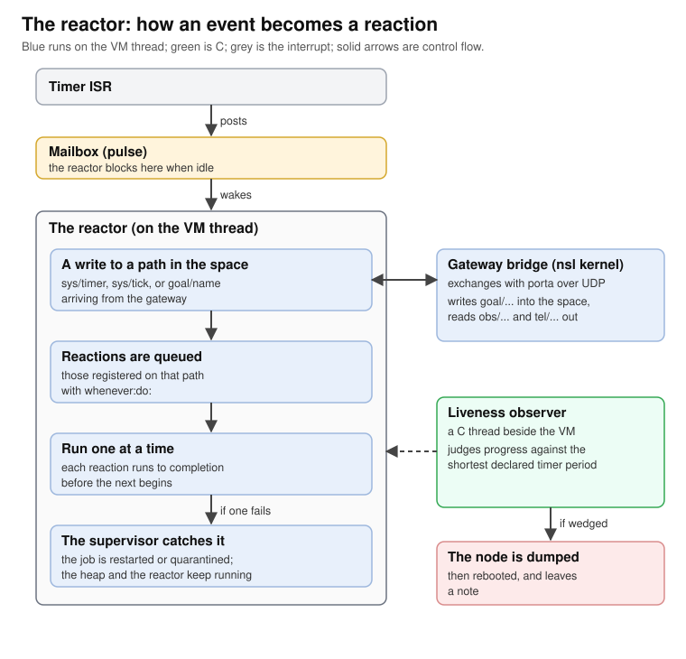
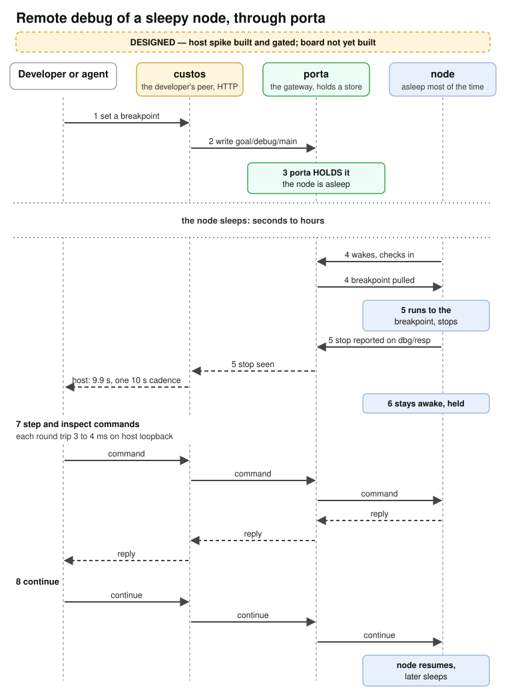
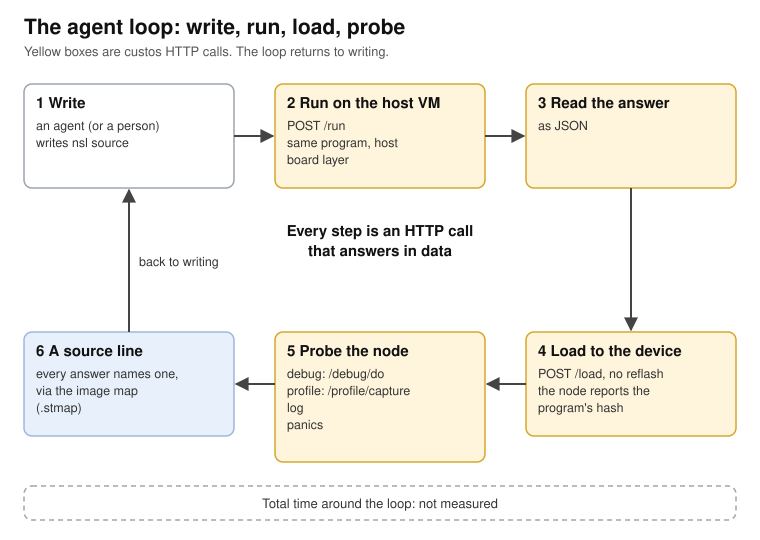

# rete: a lifecycle for small radio nodes on Zephyr — what is built, what it costs, and what is not

_DRAFT 4, 2026-10-10 (§9 built on both bells; §3 the AOT encoder; Appendices A–C in the lifted-references form, decided 2026-10-09; a bare-listings copy and a paginated PDF beside it), for iteration with David. The companion paper, on the language, is [nsl-design-paper.md]; each topic has one owner and the other paper cites it._

Sources are bracketed keys, e.g. [VM], resolved in the References; in this Markdown they are links, and only there.
Anything that is designed but not built says so in the sentence that describes it.

## Abstract

This is a report on a system called rete: what was built, why, what it costs, what it does not do, and how it tries to
improve the develop, deploy and manage lifecycle of a small radio node. Zephyr reaches more than 900 boards, with
connectivity, security and drivers built in; its community names the learning curve as its most persistent cost
[ZT10]. rete puts a small object language, nsl, on top of Zephyr, and builds the lifecycle tools around it.

The costs come first. The interpreter is about a hundred times slower than C on the one method measured both ways, the
VM takes 112 KB of a 256 KB part, and no model was trained on nsl. In return, a program can be changed without
reflashing the firmware; debugging, patching and profiling are driven from a host over the one USB cable already on the
bench; a gateway holds what a sleeping node is to be told until it next wakes; and the loop is short enough to check, by
running it, the code an agent wrote.

*Status: a lifecycle system whose desk half (host VM, USB load, debug, patch, profile) is built and measured, and whose
field half is built for debug, program over the air and profile on both demo nodes; version 0.1 ships when every verb
is shown there (decided 2026-10-09), so nothing in the release is labelled "designed".* Remote debug through a gateway
was run on two boards on 2026-10-09 and 2026-10-10, a deep-sleep node over WiFi and an always-on node over Thread, a
program was pushed through it to each on 2026-10-12, and each was profiled through it on 2026-10-14 (§9).

## 1. The problem

Shipping a node is an obstacle course of five things: the chip (choose, source, bring up and live with it for a decade);
the drivers (every sensor and bus, written and then maintained); the software (application logic safe enough to run
unattended); deployment (the first version out, and the fiftieth); and maintenance (diagnosing and fixing a fault in a
device you cannot reach). Only one of them is a language problem, and it is not the one benchmarks measure [Perf].
Zephyr removes the first two. This paper is about the last three, and how rete tries to improve them [Script].

Three problems sit under that frame. None is new or claimed solved.

**The learning curve.** Zephyr's ten-year survey reports it as the most persistent challenge for contributors
[ZT10]. A newcomer who wants a sensor reading on a radio node meets devicetree, Kconfig, west and the
network stack's configuration before any application logic runs. The layers are not the subject here; the application
on top of them is.

**The field node you cannot reach with a probe.** On the bench, a node has a debug probe or a cable. In a wall, on a
roof or in a box, it has neither. It reports through a weak, slow radio and often sleeps for minutes or hours between
exchanges. The usual tools are the log it chose to send and a site visit. A fault that appears only in the field,
after a week, on the node that is hard to reach, is the one you would most like to stop at a line.

**Code an agent wrote, and no way to trust it.** Zephyr's contributors already use AI to write code and do not trust it. Of 125 contributors surveyed, 54 % say it helps them write code faster, and 54 % say it gives unexpected or
incorrect output they must fix frequently; 33 % spend more time validating its output than they would writing from
scratch; 18 % say it helps them write code with fewer errors; and 78 % do not trust its suggestions without heavy
review ([ZT10], Figure 35). This is a verification problem: generated C must be read closely, line by line.

## 2. Lineage: the 1996 answer, with the liveness moved off the node

The idea of a high-level object language on an embedded target is old. Kim Clohessy of Object Technology International
(IBM) described it in *Using object-oriented programming tools to build real-time embedded systems* [Clo96]. His
account, in the facts this paper uses:

- In most real-time embedded systems only about 10 % of the code is time-critical; the rest runs at human speeds. A
  high-level language is used for that rest, and C or assembly for interrupt service routines and hot mathematics.
- The VM and the executable part of the image are burned into ROM, with object state in RAM.
- Development happens on a host, and a packaged image is downloaded to the target.
- The target hardware and its environment are modelled in software, so the application runs before the hardware exists.
- He closes by claiming that the three historical barriers, no cross-development tools, images too large and
  inadequate performance, "have been overcome", and remarks that profiling tools "will probably never be considered
  good enough".
- His Smalltalk kept on the target a live image, an in-image debugger, a process model, an easy call to C and "fixed"
  (non-moving) objects.

rete keeps the first four. A 256 KB radio part cannot carry what his Smalltalk kept on the target: a live image and an
in-image debugger cost more RAM and flash than the part has to give. So the liveness is moved off the node. The node holds a frozen, read-only
image and a confined mirror that a debugger can use; the gateway (porta) and the desk peer (custos) hold the rest of
what a live image gave, and reach the node through the wire. The same split decides where the debugger, the patcher
and the profiler live (§8, §9).

The earlier record is Barry's OOPSLA '89 paper [Bar89], Clohessy's own reference: a radar signal processor
prototyped in Smalltalk on 68k VME boards, with the live image on the target. Three of its practices are rete's,
unchanged after thirty-five years. The system was begun as a simulation and grown by stages, developed on PCs and
moved to the target unmodified, which is Clohessy's fourth point and rete's host VM first (§5, §7). Optimisation was
deliberately postponed until the architecture was stable and then measured, "no guesswork", which is §3. And the
first of its three optimisation options was to re-code a frequently invoked method as a primitive in C or assembler,
which is the mechanism below. The paper also records a cost this one concedes in §11: its experienced C programmers
took two to four months to become effective in Smalltalk, and "most found the long training period discouraging". Its
closing open question, whether there is room for code at an intermediate level between Smalltalk and assembler and
where the boundary falls, is the question rete #383 and the companion paper's three kinds of C are still answering.

One mechanism carries over from this lineage and is owned by the companion paper [Lang]: every operation is a send,
and a send finds its method in a table, so whether a method is interpreted or C is one field of its binding. A hot
method can move to C without its callers, the interpreter or the image format changing. That is native substitution.
Its per-activation cost, and the one direct comparison with C, are in the costs table (§11).

## 3. Where the time goes: two measurements

The VM is not the bottleneck on one workload, and is on another. Both are real.

**(a) A sensor and a web page.** Rung #61 (2026-07-21) measured `ThermalHttpNode` on a classic ESP32 (WROOM-32): a
Grid-EYE thermal sensor read over I2C, with 310 thermal jobs and 296 paced HTTP requests, timed on the board with
seven spans [Spans]. Four of them:

| Span | Mean | Max / min |
|---|---:|---:|
| `acquire` (the I2C read) | 12,798 µs | 1.24× |
| `vmCompute` | 4,101 µs | 1.21× |
| `publish` | 8,225 µs | 1.15× |
| `egress` (the network, C-owned; provisional, see below) | 1,319 µs | 727× |

Everything the VM does for a job (`vmCompute` plus `publish`) is 12.3 ms, at parity with the sensor read. Two thirds of
the VM's share was copying the same 64 numbers twice, an OrderedCollection build and then a `List fromCollection:`.
The network half is provisional: it comes from a run paced below the node's connection ceiling, on a build whose
receive-packet slab was itself the bottleneck (#65, fixed 2026-07-22, not re-taken). On that run the client's median
round trip was 159 ms and `egress` spread 727× from its minimum; the roughly 119 ms of network (75 %) is a subtraction,
not a measurement. The VM's work is predictable and at parity with the sensor; on that provisional run the network is
the wild part; and garbage collection on a saturated heap sat inside the mean, not in the tail: the heap was pegged at
53,228 of 53,248 B with 1,523 collections during the run, and `vmCompute` still showed a max/min of 1.21×.

**(b) The CBOR encoder, the one place the cost was felt.** Every node encodes what it sends to the gateway as CBOR.
The encoder is nsl, with C only at the leaves: integers, floats and the decode heads have been primitives since the
codec's first version (2026-07-09). On an ESP32-C6, encoding the gateway's real 425-byte push frame took 124 ms; a fix
in nsl alone (less copying, a cheaper byte buffer) halved it, to 53 ms, about a quarter of a check-in [Checkin].
Measuring where the rest went showed that the cost is the walk itself: about nine interpreted activations per byte, of
which the CBOR logic is half a percent [CborShape]. At a check-in every two seconds that is tolerable. At a 50 Hz
control loop it is the whole tick.

A spike tried four ways of encoding the same frame, all producing identical bytes, on the host (2026-10-04) [CborArms]:

| Arm | ns per encode, host | Against today |
|---|---:|---:|
| Today: the walk in nsl, C leaves | 259,950 | 1× |
| More of the leaves in C, the walk still in nsl | 86,595 | 3× |
| The whole walk in C, which knows the container classes | 1,904 | 137× |
| The walk in C, finding each container's encoding through its class's method table | 2,045 | 127× |

More leaves in C buys only 3×; the walk has to move. The chosen design is the last row: each container class declares
in one line of nsl that its encoding is native, and the C walk asks each class's method table for that binding, so C
does not name the class hierarchy, and the nsl encoder stays as the authority for anything C refuses [CborNative].
**This is designed and planned (rete #297), not built.**

A second spike (2026-10-09/10) asked whether the walk has to be written in C at all, or whether the nsl encoder could
be compiled ahead of time, with the sends it makes to nsl-defined objects kept as calls back into the VM. Three
encoders of the same 425-byte frame, byte-identical, in one binary on an ESP32-C6 [CborAot]:

| Encoder | per encode, ESP32-C6 | Against today |
|---|---:|---:|
| Today: the walk in nsl, C leaves | 43.6 ms | 1× |
| The nsl encoder compiled, every send to an nsl object kept, each held object rooted | 1.45 ms | 30× |
| The whole walk in C, which knows the container classes | 0.15 ms | 280× |

A kept send costs what an interpreted activation costs, about 23 µs on this part, and that is the whole 9.5×
between the second row and the third; rooting a fresh object across a send, which a C local does not do here, costs
about 3 µs more. The second row is enough: it takes the encoder from a quarter of a check-in to noise, from one
source of truth, and the price of that path is a compiler that knows each send site's receiver class, which no
instrument collects today. Both compiled arms were hand-written C standing in for a compiler's output; the ratios are
the device's, the compiler is not built.

Decisions are cheap, per-byte walks are not, and the fix for a walk is native substitution [Lang].

## 4. The system at a glance



_Figure 1. Field nodes (A′, B′) run commissioned images and reach the gateway over Thread or WiFi; porta mirrors
each node's state and keeps the images it commissioned. Each developer works on a twin on the desk (A, B) over one
USB cable, and on test nodes on the desktop's VM, through custos, with the same HTTP calls whether a person or an
agent makes them. A and A′ drift apart while a bug is chased on both, which is why porta, not the developer's
machine, is to be the custodian of what runs in the field (decided; the commissioning step is not yet built).
Reaching a field node's debugger through porta is built and was run on both bells, 2026-10-09 and 2026-10-10, with
no cable on the board (§9) [Field]._

porta (Go, always on), custos (Go, on the desk) and the node meet only in the wire format `protocol/` [Porta], [Peer].

**porta** is one always-on Go binary on the gateway host, with a SQLite store. It mirrors each node's `obs/` and `tel/`
paths. It holds intent written under `goal/` until a node that is asleep, and so has no address to be called on, next
wakes and asks. It refuses any write the manifest does not declare. And it judges each node's liveness from outside,
against the cadence the node declared [Porta]. Retaining each commissioned image and its symbol map at porta, as "the
custodian of what runs in the field", is decided and not built.

**custos** runs on the desk, holds the board's cable and serves the HTTP verbs; a person and an agent make the same
calls [Peer]. **The node** runs the VM as one Zephyr thread over a read-only program image, with Zephyr in C beneath it.



_Figure 2. One node. Zephyr, OpenThread and mbedTLS are C and unchanged. The VM is one Zephyr thread running a
read-only program image in place from its own flash partition; the liveness observer is a second C thread watching
its progress. The console cable carries the log, the loader and the debugger's lines._

RAM is the tight resource. On the nRF52840, with the Thread build of 2026-10-03, Zephyr, OpenThread and
mbedTLS take about 140 KB of 256 KB, the VM's arena gets 112 KB, and 4 KB are spare at link time [Lang], [Boards]. The VM's code is about 42 KB of a 1 MB flash, so flash is not the
axis that binds.

## 5. What you write

An nsl program is a class whose header names what it was given. It keeps state under path names in a **space** and
reacts to writes at those paths. Appendices A and B show one whole program in its two power modes: the ship's-bell
clock as the MagTag runs it, asleep between half-hours, and as the wall-powered C6 runs it, always on — both
written over one library of classes with one responsibility each (Appendix C) and a `main:` that reads as the
order of one wake, or of one boot. Two parts follow.

The first is that order. The node is asleep between wakes and the VM does not exist while it sleeps, so there is no
loop here: a wake strikes, syncs if it is a watch end, joins the gateway, reports, and sleeps.

```
record valid
  ifTrue:  [ self strikeWake ]
  ifFalse: [ self coldBoot ].

self joinPorta.            (* the first check-in replays the breakpoint set *)
self report.
space drain.               (* the row above is captured by a reaction; only a drain runs it *)
bridge checkIn.
^ self sleep               (* NEVER RETURNS *)
```

The second is the method that reports, once per wake:

```
report = (
  space out: 'tel/log' value:
    (platform Record tag: #Log with: #lvl -> #info
       with: #txt -> (summary , ' up ' , record bootTicks printString
                      , ' held ' , bridge heldExchanges printString)).
  ^ self )
```

It appends one row to a log stream; the bridge pushes it at the next exchange. The node in Appendix A uses these
paths across the wire:

| Path | Kind | Who writes it | Who reads it |
|---|---|---|---|
| `goal/debug/main` | cell | the gateway, as intent: the breakpoint set | the node, at its first check-in of every wake |
| `obs/build`, `obs/liveness` | cells | the node, as what it is and how often to expect it | the gateway |
| `tel/log` | stream | the node, a row per wake (the wall node: a row per strike) | the gateway, every row |
| `sys/metrics` | cell | the kernel, the arena's numbers | the gateway |

A *cell* holds the latest value; a *stream* is append-only. Every path that crosses the wire has its kind and record
shape declared once, in the protocol's manifest, and the gateway refuses a write that disagrees [Manifest]. Paths
under `sys/` stay on the node.

**Your Zephyr driver, a 13-line kernel class, and four primitives.** There is no FFI. A device is reached through a
*primitive*: a selector on a closed list, 160 of them today, each backed by one C function that calls the Zephyr
driver API. To bind a new driver, a firmware author appends one name to the list, writes the C function, and adds
the kernel method that hands the device out through `platform`. An application cannot add a primitive of its own
[Serial]. The driver in Figure 3 is Zephyr's; nsl adds glue.



_Figure 3. `display at: 4 col: 0 put: …` from the app down to the panel. The driver is Zephyr's (its character
framebuffer and the uc81xx e-paper driver); nsl adds a 13-line kernel class, four primitives, and the C that hands
their arguments to Zephyr. The host has its own board layer, a real character grid, so the same program can be
checked on the desktop first [Display]._

<p align="center"></p>

_Figure 4. The same primitives in service: an nsl clock node on a MagTag, 19 days up, showing its heap, clock drift
and last NTP check. Photographed under the previous project name, `tuvm` [Clock]._

The cost: someone must write the C. The language moves driver work to the firmware's author and keeps it out of the
application; it does not remove it.

## 6. The reactor in practice

Zephyr is multithreaded and nsl is not. The VM runs on one Zephyr thread, with OpenThread, the network stack and the
liveness observer in threads around it. Inside nsl, one reaction runs at a time, to completion.



_Figure 5. From interrupt to reaction. A timer interrupt posts to a mailbox and returns; the reactor, blocked on the
mailbox when idle, wakes, queues the reactions that care about the written path, and runs them one by one. The
supervisor catches a failed reaction; the liveness observer judges progress from outside._

**The cost is the one every event loop has.** A long computation starves the timers, because nothing can interrupt a
reaction; the answer is to split it across reactions. The guard is the liveness observer, a C thread that judges
progress against the shortest timer period the program has declared. A wedged node is dumped, rebooted, and leaves a
note saying why [Liveness].

What the cost buys:

- **No locks in nsl code.** A reaction cannot be interrupted by another, so shared state needs no protection. Races
  are impossible in the nsl layer and remain possible in the C beneath it.
- **One stack**, where threads cost one each; the July 2026 rewrite that removed fibers removed theirs [Pivot].
- **A failed reaction is caught, not fatal.** The supervisor keeps the heap and reactor running and restarts or
  quarantines the job [MD].
- **A wedge leaves evidence:** the observer's dump and note.

**Always-on and deep sleep.** A node's power mode is a value at a path, written by the gateway and acknowledged by
the node, not a command [Porta]. An always-on node (the mains profile) runs a loop that never returns. A deep-sleep
node wakes, reads, exchanges with the gateway and sleeps; `platform deepSleep:` never returns and the next wake is a
full reboot, so the program is declared run-once. Deep sleep runs on the MagTag today.

Every exchange is started by the node. A sleeping node has no address to be called on, so the gateway holds what it
wants, a new setting or a new program, until the node next wakes and asks. §9 depends on this.

## 7. Develop without reflashing

The firmware is flashed once. The program is a read-only image in its own flash partition, run in place, and the
firmware reads the partition at boot [Image]. The first two steps need no board.

**Build and run on the host.** The compiler turns a `.nsl` file into an image, and custos runs it once on the desktop VM. The body is the source; the answer is the output and exit status, or the
compiler's own `file:line:col` message if it does not compile.

```
curl -s --data-binary @average.nsl \
     'localhost:6971/run?for=dev&name=average.nsl' | jq
```

The answer, captured on the host VM on 2026-10-08 (the hash is shortened here):

```
{
  "Board":    "dev",
  "Image":    "average.oimg",
  "SHA256":   "d4200f2c…71892",
  "Output":   ["oevm: build-id host",
               "oevm: program sha256 d4200f2c…71892",
               "mean 4"],
  "Exit":     0,
  "TimedOut": false
}
```

**Build, then load onto the device.** `POST /build` takes the same body and answers the image's name, hash and size; the agent fetches the image and posts
it to `POST /load`. Build and load stay two verbs [Peer].

```
curl -s --data-binary @average.nsl \
     'localhost:6971/build?for=c6spare&name=average.nsl' | jq
curl -s 'localhost:6971/build/last.oimg' -o average.oimg
curl -s --data-binary @average.oimg \
     'localhost:6971/board/c6spare/load?name=average.oimg' | jq
```

The load answer, captured against the host VM (on a board, `BuildID` is the firmware's and `Offset` the
partition's):

```
{
  "LoadedMs": 1791474679885,
  "Result": { "Image": "average.oimg", "Size": 229160, "SHA256": "d4200f2c…71892",
              "BuildID": "host", "Offset": 0 },
  "Debug": ""
}
```

A load succeeds only when the node then boots the same firmware and reports the same program hash on its console.
That proves the program loaded, not that it runs correctly. On a board, the load closes the console cable, writes the partition with the board's flasher, resets, reads the two boot lines, and
reopens the cable. Only the ESP32-C6 has a loader today.

**What is not measured.** The loop has not been timed from an edit to a program running on a board, and this paper
claims no number. It is shorter than a firmware reflash because no firmware is rebuilt or written.

## 8. Debug, patch and profile over USB

A small device usually means `printf` and a reflash. These tools reach into the running VM over the board's one USB
cable, through custos, which holds it. Each is an HTTP call that answers JSON, with a web page and a
terminal front over the same calls [Peer]; HTTP is the only surface the tutorials advertise.

| Tool | What it does today | Record |
|---|---|---|
| **load** | replaces the program without reflashing; the node reports the new hash (ESP32-C6) | [Image] |
| **debug** | breakpoints by source line; `step`, `next`, `finish`, `pause`; the stack and named local variables at a stop | [Debugger] |
| **patch** | in a debug build, replaces one method of a program stopped at a breakpoint, restarts the frame, and continues into the new code; shown on an ESP32-C6 on 2026-10-06 | [Patch] |
| **profile** | per-method call counts from the standard image on the ESP32-C6, so a field node is profiled without a reflash; it costs 1.3 % on the worst-case benchmark | [Profile] |
| **log** | the node's log and console, collected by custos | [Console] |

Every one of these names source, not addresses: the image map beside each image gives every method's file and line
[Image].

**The costs first.** The debugger needs a separate image: the checks that make breakpoints possible cost 11.6 % per
bytecode and about 500 B of flash, so the standard image leaves them out [Debugger]. On a board, every bytecode step
is a round trip over the cable, about 0.2 s on the C6, and a line step is many of them: the first `next` in the
tutorial's transcript took 3.6 s. A long loop is better crossed with a breakpoint after it. A
breakpoint does not fire during `next` or `finish`, because the Supervisor decides each stop by frame depth alone.
Hot patching is limited to methods whose new version uses only constants the image already holds [Patch].

**A stop, as data.** A stop is waited for by long-polling `GET /debug/state?after=N`, never by sending a command, because any command that reaches
a running program stops it [Debugger]. The executed example, on the tutorial's `Average` program on the host VM:

```
curl -s -d 'break 16' "$base/debug/do"
curl -s -d continue   "$base/debug/do"
curl -s "$base/debug/state?after=$seq"      # long-poll, 25 s at most
curl -s -d step       "$base/debug/do"
curl -s -d bt         "$base/debug/do"
curl -s -d locals     "$base/debug/do"
```

The `State` has the fields `Seq`, `Image`, `Run`, `Stop`, `Frames`, `Locals`, `Breaks` and `Transcript`. After
`step` into `sum:`, captured on the host VM on 2026-10-08 and cut to the stop, stack and locals:

```
"Run":  "stopped",
"Stop": { "Reason": "step", "File": "average.nsl", "Line": 8,
          "Method": "Average>>sum:", "Off": 7968, "PC": 1 },
"Frames": [
  { "Where": "at average.nsl:8  Average>>sum:", … },
  { "Where": "at average.nsl:16  Average>>main:args:", … },
  { "Where": "at supervisor.nsl:41  Supervisor>>run:platform:args:debug:", … } ],
"Locals": { "Where": "at average.nsl:8  Average>>sum:",
            "Vars": [ { "Name": "self",  "Value": "an Object" },
                      { "Name": "xs",    "Value": "an Object" },
                      { "Name": "total", "Value": "nil" } ] },
"Breaks": [ "average.nsl:16" ]
```

The same calls drive a board; only the base URL changes.

**A patch.** The body is the edited `.nsl`, with the method named in the query [Peer]:

```
curl -s --data-binary @average-edited.nsl \
     'localhost:6971/board/c6spare/debug/patch?method=Average>>sum:' | jq
```

**A profile.** The request names a window in milliseconds; the answer ranks methods.

```
curl -s -X POST 'localhost:6971/profile/capture?ms=200' | jq '.Report.Rows[:5]'
```

Each row has `Name`, `Count`, `Pct` and `Unknown`. The program must dispatch `sys/timer` and outlast the window; a program that ends before its
window closes answers 502 at once [Debugger].

The patch row is one board, one method and one session: a demonstration, not a survey of patches.

## 9. Remote: through the gateway, to a node that is asleep

**The debugger through the gateway is built and has been run on two boards** with no cable on either: the MagTag,
which deep-sleeps, on 2026-10-09, and the wall-powered ShipsBell C6, which runs continuously, on 2026-10-10
(#375–#377, #379, #380) [Field]. It was designed on a host spike that runs a real porta and a host VM on the desktop
and prints `SLEEPY DEBUG OK` [Spike]. Program over-the-air load (#233) was proven on a bench C6 over Thread on 2026-10-10
and on both demo nodes on 2026-10-12, and the profiler on both on 2026-10-14 (below) [Field].



_Figure 6. A breakpoint set at the gateway is held by porta as intent and delivered when the sleeping node next
asks; the node reports the stop and stays awake while the developer steps._

**The mechanism (peer design D9, D19).** A breakpoint is intent, so it is written under the node's `goal/` paths, and
porta holds it until the node next wakes and asks. On a hit, the node reports the stop and stays awake, one exchange per command. The
liveness observer already knows not to reset a node held at a breakpoint over USB [Debugger], and the VM holds
the same state whichever link serves the command loop (#377). The
`Debug` record in the manifest carries the breakpoints and the program's hash, because a breakpoint is an offset
in one image, and an `obs/debug` cell reports a held node (#375). The whole set is one cell: the empty set is
the detach.

**Two kinds of sleep** need different machinery; the spike exercised both on the host.

| | VM stays alive (long check-in cadence; Thread sleepy end device) | VM dies (deep sleep: every wake is a cold boot) |
|---|---|---|
| Where the breakpoint lives | the VM's breakpoint table, set by lines on `dbg/req` | the `goal/debug/main` cell: porta replays cells to a fresh boot, and replays no `dbg/req` row |
| When it is applied | at the next check-in | inside the first check-in of every wake, before the program's work |
| Proven by | gate leg A | gate leg B |

**The spike's measurements** (host, loopback, 2026-10-07) [Spike]:

| Measure | Value |
|---|---|
| Breakpoint written to stop reported in porta's store | 9.9 s, one 10 s cadence; the breakpoint waits at porta for the next check-in |
| One debug command while held | 3–4 ms |
| Held exchanges | about 1,600 per second (63,666 in a 39 s hold, manual run) |
| Node CPU while held | 99.9 %: the debugger polls and does not sleep |
| porta's store during a 39 s hold | its write-ahead log grew about 4 MB, since each pull is a write |
| After `dbg:continue` from that hold | three ticks fired back to back, the cadence timer catching up |

The spike also falsifies its own gate: breaking the `dbg/req` intercept turns leg A red, breaking the
`goal/debug/main` intercept turns leg B red, and a control leg sending the same rows to a standard image gets no
answer.

**On the boards** (the two bells of Appendices A and B, each on its shipped debug image, the breakpoint written at
the gateway as the `goal/debug/main` cell) [Field]:

| Measure | MagTag, WiFi, deep sleep (2026-10-09) | wall C6, Thread, always on (2026-10-10) |
|---|---|---|
| Cell written to stop reported | the first check-in of the next wake: `work:` stopped 1 s after boot | 56 s: the cell rode one 30 s check-in, the break hit at the next |
| `backtrace` / `inspect` / `step`, gateway to node and back | 755 / 636 / 754 ms | 239 / 233 / 230 ms |
| Held | 26 s; 186 collections, live 23 KB of 28 | 1.2 s |
| Release | `continue`; the next boot pulled the empty set and ran free | the empty set: cleared in 479 ms, the next check-in missed nothing |

A command's round trip is the node's held-exchange cadence, not the radio: about a quarter of a second on the C6
and three quarters on the MagTag, against 3–4 ms on the loopback. A breakpoint is placed by what runs: the wall
bell's `onTick` runs only at the alarm, so a break there would have held the bell at the alarm and delayed the
ring, and the break went on `checkIn`, which runs every 30 s.

**The costs.** Holding a node costs a busy CPU, which a battery node cannot afford; the MagTag's arena ran 186
collections in its 26 s hold. The
spike's own proposal, a long-poll at porta, was not accepted, and what an abandoned session should do is open (#378).
The store growth of about 4 MB in 39 s on the host is a cost on the gateway, at a rate the boards' held cadence
divides by several hundred. The `obs/debug` cell reports the hold, so a monitor with no debugger attached sees it,
and the debug image no longer waits at boot for a cable (#376).

**Program over the air (#233).** The firmware holds two program slots and runs one in place; a push is a signed
record in the goal tree naming an image porta serves in 256-byte blocks; the node fetches it into the other slot on
its own thread while it keeps checking in, reboots once into it, and the firmware confirms the new image at its first
exchange or resets after 150 s and reverts to the previous slot. On a bench C6 over Thread on 2026-10-10 [Field]: a 167 KB
image fetched at 3.3 KB/s, 64 s from push to confirmed; an image that never checked in was reverted after exactly 150 s;
a flipped signature byte was refused before the image ran; a reset half-way through the fetch cost one full refetch
(the fetch cursor is not yet kept across a reboot) and still converged. A rejected or reverted image is refetched at the
next check-in, about a minute of radio per retry, until the goal changes (#175, #426).

**On the demo nodes** (2026-10-12; both reflashed by cable from one source first, then pushed through porta with no
cable) [Field]:

| Measure | MagTag, WiFi, deep sleep | wall C6, Thread, always on |
|---|---|---|
| Image | 177 KB | 131 KB |
| Stage | 9 s, inside the awake window, in the check-in itself | 30 s (about 4.4 KB/s) on its fetch thread, checking in every 30 s throughout |
| Goal written to confirmed | not timed: the goal waits for the next wake, whose check-ins stage, reboot and confirm | 3 min |
| Next bell | 18:30, on time | 18:30, on time |

The MagTag stages in the check-in rather than on a thread of its own: its RAM cannot spare the thread's stack, and a
node awake only to check in has nothing else to do. Its trial boot is not a timer wake, so it does not strike, and
it sets its clock at once without scoring the gap as drift: before the catch-up was added, a stale goal made it
stage and fail two trials after a cable flash, the firmware held each for 150 s, and it rang 5 min 46 s late, which
an ordinary sync would have read as about 87,000 ppm of drift. After a push the breakpoint cell still names the old
image, and the new one refuses it until it is rewritten, since a breakpoint is an offset in one image. On the bench
the push was driven from porta's command line. An agent drives it through custos, the same `POST /load` it uses on a
cable (Appendix D): on the wall C6 on 2026-10-12, one request to custos had the new program staged in about a
minute and its trial confirmed 2 min 37 s later, the agent polling `load/last` until it read `Converged` (#398).

**The profile through the gateway (#415).** The request is intent, so it is a cell: `goal/profile` = `Profile{id, ms}`,
one window, served once. The rows are not: a dump is about 10 KB, which the gateway's size law keeps off the space, so
they leave on the console's UDP tee, one datagram per line, to wherever the `goal/console` cell points. custos writes
both cells, its own address in the second, so the rows come back to the custos that asked; porta relays two writes and
reads no row [Profile415]. Sleep shapes the rest. The node keeps the request and the tee's target in memory that
survives deep sleep, so a waking node tees from its first line. A window that a sleep cuts is carried, and the next
wake opens it whole before `main:`. Before it sleeps, the node drains the console until the radio reports every frame
sent, at most 2 s. An agent's request is `POST /board/<n>/profile/capture?ms=N` to custos, polled at `profile/last`,
the same verb as on a cable (Appendix D).

| Measure | MagTag, WiFi, deep sleep (2026-10-14) | wall C6, Thread, always on (2026-10-14) |
|---|---|---|
| Request to rows | two wakes: a check-in delivers the request, the sleep cuts the window, and the next wake opens it from boot and dumps it at its own sleep | 8 s to custos's ranked answer, for a 5 s window |
| Rows | 256 of 256, header and `end` included, in 1.2 s at the wake that dumped the carried window | 183 of 184; custos warned of the missing row rather than ranking short |
| The radio's count | `given 365, done 365, refused 0` | not counted |
| Drain before the sleep | 20 ms | no sleep |

Three things the boards needed that the host gate never asked for. Over Thread, `sendto` accepts a datagram that
OpenThread later drops when its buffer pool is full, so the console waits before each line until the pool has room.
Over WiFi, the driver hands a frame to the vendor's blob and frees it, so the drain waits on the blob's own TX-done
count, and the sender keeps at most half the blob's buffers in flight. And at a wake, a line sent before the
neighbour answers or before the address leaves tentative is lost without an error, so the console holds its lines
until the stack can pick a source address the gateway can answer. A lost line is a lost row, so custos counts the
rows against the dump's header and warns.

## 10. Trusting code an agent wrote

The problem is verification, and an agent verifies by running things and reading what comes back. Two questions
follow: what bounds what an agent's code can do, and what lets it check its own work? Whether the language suits an
agent is the companion paper's argument [Lang].

**What bounds the code.**

- **Authority is visible in the header.** A module that can use the network says so in its signature, and a channel
  capability can only be narrowed.
- **The primitive set is closed.** There are 160 primitives, and an application cannot add one.
- **There is no FFI.** An agent cannot wander into C to get around the first two.

The companion paper owns these [Lang]; they bound the effects of an error, not its likelihood.

**Not yet true.** `platform` hands out every device today (ledger row 32 [Ledger]), so a program that receives it can
reach all of them and the header's visibility is weaker than the design.

**What lets the agent check its work.** Every custos verb has a machine-readable HTTP path before any human front
(D11, D12), gated against a real VM the way an agent drives them [Peer]. Every crash and profile sample names a
source line.



_Figure 7. The loop an agent runs: write a program, run it on the host VM, load it onto a board, probe it with a
breakpoint or a profile, and read the answer as data. Each step answers JSON and names a line. How many errors the host run
catches before a board is touched is unmeasured._

An error from the compiler is a `file:line:col` message. A message not understood names the
receiver's class and the nearest selector it does understand [Lang].

**What this does not show.** Nobody has measured anything about agents on this system, including whether an agent
writes more correct nsl than C. The expectation is that a short, repeatable loop makes each check cheap; the 33 % in §1 spend their time on
checks that are not cheap. The test that would settle it gives the same small board tasks to an agent in nsl,
with the language in its context, and in Zephyr C, scored on first-run correctness. It has not been run (rete issue
#373); the result will be published either way.

One more caution. Verification by running catches only what running reveals. A reaction that is wrong only under a
timing or radio condition the host VM does not reproduce passes on the host and fails on the board; the host suite is
blind to the interrupt seam, and nothing in this loop closes that gap.


## 11. Costs compared with Zephyr C

| Cost | Compared with Zephyr C | Would lift it |
|---|---|---|
| Speed per byte | about 12 µs per method activation: 11.83 µs on the ESP32-C6 and 11.13 µs on the RP2350 [RP2350]; about a hundred times slower than C on the one method measured both ways, and 116–119× on the Towers of Hanoi spike, a best case with all the work in one method [Hanoi]; no JIT, because a 256 KB part has no room for a code cache | native substitution of a hot method (§2, §3); or leave it in C; or compile the nsl method ahead of time with its sends kept, which on the encoder returned 30× of the C encoder's 280×, each kept send costing an activation and each rooted object 3 µs (§3) [CborAot] |
| RAM given to the arena | 112 KB of 256 KB on the nRF52840, with 4 KB spare at link [Boards] | a larger part; the C6 has 128 KB of arena by choice, and WiFi sets the classic ESP32 to 48 KB |
| No compile-time types | a misspelt selector is found when it runs, not compiled | the error line names the nearest selector, which softens the cost [Lang] |
| A language in no model's training data | an agent writes nsl from context, not habit | the test in §10 (#373); not yet run |
| A dialect to learn | a C programmer learns a Smalltalk dialect; the 1989 record put it at two to four months for experienced C programmers, with the training period itself the discouraging part [Bar89] | unmeasured for nsl; the surface is one kernel and 160 primitives rather than a Smalltalk image [Lang] |
| One kernel | no virtual classes, no per-target library, `platform` hands out everything [Ledger] | narrowed platforms (row 32) |
| Tooling at version 0.1 | the compiler is a Python tool, and the loader exists for one board, the ESP32-C6 | more loaders; each board needs its own region and flasher |
| Debug images are separate | 11.6 % per bytecode and about 500 B of flash [Debugger] | not planned; the standard image stays lean |
| Remote debug is slow per command | 230–750 ms per command through the gateway, the node's held cadence, against 3–4 ms on the host [Field] | a shorter held cadence, paid in the held node's radio and CPU |
| A single maintainer | one maintainer for the VM, kernel and tools | not planned |

### Against MicroPython

MicroPython has a decade of use, a large library of drivers written in Python, a REPL over the serial cable, deep
sleep on the ESP32 family, and program load by copying files; and it is in every model's training data. Per call it is
likely faster than nsl, and that is unmeasured.

What rete has that MicroPython's core does not: a gateway that holds intent for a sleeping node behind a
manifest-checked wire; a source-line debugger and a per-method profiler over the cable; a liveness observer that dumps a
wedged node and says why; and a closed primitive set with no ambient device module.

The July review decks already placed nsl beside Toit, MicroPython on Zephyr and AtomVM, and bet that confinement,
supervision, remote serviceability and Zephyr's driver catalogue decide whether a scripting layer survives production,
not types or benchmarks [Script]. The comparison that answers the question is rete #383: the same C6 node written in
MicroPython, scored on measured rows; several rows MicroPython wins, which is the point of running it [MP].

### Where this stands

Today rete is a lifecycle system whose desk half (host VM, USB load, debug, patch, profile) is built and measured, and
whose field half is built for debug, program over the air and profile (the two bells, through the gateway, over WiFi
and over Thread, §9). Version 0.1 ships when the
field half is built (decided 2026-10-09), so nothing in the release is labelled "designed". Not yet shown: an agent
writing C against an agent writing nsl.

Version 0.1 is defined as one node, every verb, through the gateway, over the radio, while the node sleeps. By
lifecycle stage, against the C toolchain the reader already has:

| Stage | The C toolchain | rete today | Version 0.1 |
|---|---|---|---|
| write | edit, compile, link | the same program runs first on the host VM; authority in the header; 160 closed primitives | the same |
| deploy | flash the firmware | load an image beside the firmware over the cable (ESP32-C6 only); a manifest-checked wire | over the cable, or through the gateway: built on both bells (#233), and driven by an agent on the wall bell (#398) |
| debug | `printf`; a probe and gdb | source-line breakpoints, the stack and named locals, patch and restart, over one USB cable; and through the gateway, on a node that sleeps (§9) | the same |
| observe | nothing | a per-method profile on the shipped image (1.3 %), over the cable and through the gateway, a window cut by sleep carried to the next wake (§9); heap statistics every check-in; a liveness observer that dumps and leaves a note | the same |
| manage | a site visit | the gateway holds intent for a node that is asleep and judges its liveness from outside | and keeps each commissioned image with its symbol map |

The cable is the desk. The last column is what 0.1 is.

<div style="page-break-before: always"></div>

## Appendix A. The ship's-bell clock as a deep-sleep node

One program, two power modes. This is the deep-sleep mode: the MagTag (ESP32-S2, WiFi) sleeps between half-hours,
and every wake is a cold boot that strikes, syncs at a watch end, exchanges once with the gateway, and sleeps again.
The always-on mode is Appendix B; the classes both name are Appendix C. The program was built on 2026-10-09 as
the image a debugger and a profiler can reach (the debugger's hooks and the method profiler compiled in; 187,768
bytes of image), checked in with the gateway, and rang six bells at 19:00 [Example].

The node's header names the platform and the network, and `main:` is the map of one wake: it names the
collaborators and the order, and nothing else. The clock's rules are in the library it names with `uses:`; the
counts came from the kernel's `Bell`, not from here. The comments are lifted out of the code into numbered
references after the file, and a `(* Ref n *)` on a line marks where each one stood; they are what an overnight
run in July paid for, and the source file keeps them in place.

**`nodus/oevm/zephyr/MagTagDeepSleepNode.nsl`**

```
class MagTagDeepSleepNode usingPlatform: platform net: net = (   (* Ref 1 *)
  | dial record drift clock space bridge summary |
) (
  gwAddr    = ( ^ 'fd3f:2e87:5f7:5554:6662:66ff:fe2f:710' )   (* Ref 2 *)
  gwPort    = ( ^ 6969 )
  localPort = ( ^ 16976 )
  chip      = ( ^ #esp32s2 )

  public main: platform2 args: args = (
    dial::   Dial new.
    record:: RtcRecord on: platform.
    drift::  Drift on: record.
    clock::  BellClock on: record drift: drift ntp: platform dial: dial.
    space::  platform space.

    record valid
      ifTrue:  [ self strikeWake ]
      ifFalse: [ self coldBoot ].

    self joinPorta.            (* Ref 3 *)
    self report.
    space drain.               (* Ref 4 *)
    bridge checkIn.
    ^ self sleep               (* Ref 5 *)
  )

  strikeWake = (   (* Ref 6 *)
    | half bells |
    half::  clock nextHalf.
    bells:: (platform bell) bellsForHalfHour: half.    (* Ref 7 *)
    ('wake half ' , half printString , ' bells ' , bells printString) out.
    (platform bell) strike: bells.
    'struck' out.
    record lastHalf: half.
    record bootTicks: record bootTicks + 1.
    summary:: 'half ' , half printString , ' bells ' , bells printString.
    bells = 8 ifTrue: [ clock trySync. self paint ].
    ^ self )

  coldBoot = (   (* Ref 8 *)
    'cold boot: free-run from 00:00' out.
    record coldInitCal: drift seedPpm stale: clock neverSyncedSec.
    clock trySync.
    self paint.
    summary:: 'cold boot'.
    ^ self )

  paint = (   (* Ref 9 *)
    | disp |
    disp:: [ | d | d:: platform display. d clear. d ]
      on: [ :e | e tag = #displayUnavailable ]
      do: [ :e | nil ].
    disp == nil ifTrue: [ 'no display; skipping paint' out. ^ self ].
    (StatsPage on: disp record: record clock: clock heap: platform heapStats) paint.
    ^ self )

  joinPorta = (   (* Ref 10 *)
    | sock |
    sock:: net udpBindPort: self localPort.
    sock == nil ifTrue: [ 'no net: running unbridged' out ].
    bridge:: platform PortaBridge
      socket: sock space: space id: platform nodeId peer: self gwAddr port: self gwPort
      spans: platform Spans new.
    bridge subscribeStream: 'tel/log'.
    bridge liveness: self cadenceMillis misses: 4.
    bridge publishBuild: self chip.
    bridge checkIn.
    ^ self )

  report = (
    space out: 'tel/log' value:
      (platform Record tag: #Log with: #lvl -> #info
         with: #txt -> (summary , ' up ' , record bootTicks printString
                        , ' held ' , bridge heldExchanges printString)).
    ^ self )

  sleep = (   (* Ref 11 *)
    | target |
    target:: clock sleepTarget.
    platform deepSleep: (self witnessSleepFor: (drift disciplined: target)).   (* Ref 12 *)
    ^ self )

  witnessSleepFor: realSec = ( ^ realSec )   (* Ref 13 *)

  cadenceMillis = ( ^ (dial slotSec + 60) * 1000 )   (* Ref 14 *)
) : (
  public packageUsing: manifest = ( ^ self new )
)
```

**References for `nodus/oevm/zephyr/MagTagDeepSleepNode.nsl`**

**Ref 1** · `class MagTagDeepSleepNode usingPlatform: platform net: net = (`

MagTagDeepSleepNode — the ship's-bell clock as a RUN-ONCE deep-sleep appliance that talks to porta (tuvm#94 stage 5; rete#379, #380).

THE REACTOR IS GONE. Between wakes the CPU is off and THE VM DOES NOT EXIST: each timer wake is a fresh boot that lives a few seconds and dies. There is no drain loop, no channel, no VM timer — deepSleep: IS the idle point. This also DELETES the timer-instance bug class that cost the stage 2 overnight run (a timer registered on one Timers, dispatched on another): there are no VM timers left to misregister.

THE PROGRAM IS ITS CLASSES (rete#380, David 2026-10-09). The clock's rules live in lib/Bells.nsl, one responsibility each — Dial (the 48 slots and the modular ratchet, shared with the always-on bell ShipsBellNodeC6), RtcRecord (the slots that survive sleep), BellClock (the predicted clock, the sync, the schedule), Drift (the ppm calibration), StatsPage (the e-paper) — and `main:` below is the map: it names the collaborators and the order of the wake, and nothing else. The invariant comments that the 2026-07-24 run paid for travel with the class that owns them; the COUNT stays the kernel's `Bell>>bellsForHalfHour:`. A backtrace or a profile row reads `Drift>>disciplined:`, not `Node>>disciplined:ppm:`.

ONE WAKE, in order. The strike comes FIRST: the bell is the product, it blocks to completion before anything else (design §8), and the ratchet accounts for the whole awake window afterwards. A watch end (8 bells) then syncs and paints, a cold boot syncs and paints without striking. Only then does the node join porta: bind, bridge, one check-in — at which the `goal/debug/main` cell is replayed into this fresh boot, so a breakpoint set from porta arms here and stops the work that follows (rete#375, #379) — the wake's row on `tel/log`, a second check-in, and the sleep arithmetic last, so that `awakeSinceBasis` has seen every second this wake spent, exchanges included. Held, the node runs held exchanges through the same link (rete#377): a stop on a node that was asleep half an hour ago is stepped and inspected from porta with no cable on the board.

No porta is not an error. `net udpBindPort:` nil (no radio in the image, or the host gate's OEVM_NO_NET) gives the bridge `socket: nil`, the #274 construction: it checks in nowhere, publishes locally, and the clock runs exactly as it did before it was bridged. The declared liveness is one slot plus an awake window, so porta reads a node that is asleep as live until it misses four of them.

Build (debug + profile image, from nodus/oevm/zephyr; the env is prj_esp32s2_porta.conf's, the bell fragment brings the panel, the speaker and SNTP back after it):

```
  OEVM_IRAM_HOT=0 VM_STACK_INIT_WORDS=2048 OEVM_HEAP_SIZE=36864 \
  METHOD_CACHE_SIZE=128 SERIAL_FIFO_CAP=256 OEVM_DEBUG_HOOKS=1 OEVM_METHOD_PROFILE=1 \
  OEVM_NTP_SERVER6=<the LAN's NTP by IPv6 literal> \
  ./run.sh --board esp32s2 --model B --node MagTagDeepSleepNode.nsl \
    --conf-extra "prj_esp32s2_wifi.conf;prj_esp32s2_porta.conf;prj_esp32s2_bell.conf" --flash
  Bench: add OEVM_LOG_UDP6=<this desktop's STABLE ULA> and listen on UDP 54330 — the
  console with no cable on the board (zephyr/src/log_udp.c; the last line before the sleep
  never arrives, which is not a hang).
```

expect (console, a strike wake): wake half 45 bells 5 struck sleep: target 1785 s cal -10513 awake 15 s sleep: arming 1804 s

uses: lib/Bells.nsl

**Ref 2** · `gwAddr    = ( ^ 'fd3f:2e87:5f7:5554:6662:66ff:fe2f:710' )`

gw85224-01 by its stable ULA (rete#390)

**Ref 3** · `self joinPorta.`

the first check-in replays the breakpoint set

**Ref 4** · `space drain.`

the row above is captured by a reaction; only a drain runs it

**Ref 5** · `^ self sleep`

NEVER RETURNS

**Ref 6** · `strikeWake = (`

The strike about to happen is a pure increment of the ratchet (design §2), and it

```
    BLOCKS to completion before any sleep (design §8: a strike is never cut off). Eight
    bells is a watch end: sync, then paint, so a FAIL shows on the glass. 
```

**Ref 7** · `bells:: (platform bell) bellsForHalfHour: half.`

the kernel owns the COUNT

**Ref 8** · `coldBoot = (`

A COLD BOOT MUST NOT STRIKE. Power returns at an arbitrary second, and a bell struck

```
    then is a bell at a meaningless time — the 20:00:56 reset that produced "1 bell" is
    the witness. Instead: free-run from 00:00 with the factory calibration seeded, sync at
    once so the clock starts on the right footing (the ratchet adopts true time — an
    advance from 0, silent, no skipped bells rung), paint the synced panel, and sleep to
    the next TRUE boundary. The first strike is that boundary's bell with the RIGHT count.
    If NTP fails all 3 attempts the free-run state stands (design §8): the next boundary
    is a slot out and the count is wrong until the first good watch-end sync. Honest, and
    no worse than before. Cold boots are rare (true power loss / reflash), so the paint
    stays inside the e-paper refresh budget; ordinary strike wakes never touch the panel
    (design §5). 
```

**Ref 9** · `paint = (`

The page is given the display and nothing else. A handler block is a real escaping

```
    closure, so `^` inside it is a compile error under the no-NLR model — capture the
    on:do: result (the display, or the nil sentinel) and decide in the method body. 
```

**Ref 10** · `joinPorta = (`

Bind, bridge, declare, check in. Over IPv6 to the gateway's ULA: the bridge awaits

```
    porta's reply on the socket it bound, and only over IPv6 do the send and the reply
    share that one socket on this board (rete#390). 
```

**Ref 11** · `sleep = (`

THE COUNT OWNS THE SCHEDULE: the clock answers the target, the calibration

```
    disciplines it, the C leaf prints `sleep: arming N s` and arms the timer. 
```

**Ref 12** · `platform deepSleep: (self witnessSleepFor: (drift disciplined: target)).`

NEVER RETURNS

**Ref 13** · `witnessSleepFor: realSec = ( ^ realSec )`

Witness seam (tuvm#94 stage 5, Task 9): the bench witness build flips this to

```
    `^ 15` so the PHYSICAL deep-sleep compresses to seconds and several strike wakes, a
    watch-end sync+paint, and a real deepSleep->timer-wake->cold-boot cycle all witness
    within minutes. The CLOCK still advances a real half-hour per wake — elapsedSec
    accrues the true target, unchanged — so the ratchet and watch-end (half 8) land
    exactly as shipped; only the wall-clock wait shortens. SHIPPING state is this
    pass-through. 
```

**Ref 14** · `cadenceMillis = ( ^ (dial slotSec + 60) * 1000 )`

ms: one slot plus an awake window (boot, WiFi association, strike, two exchanges),

```
    the period porta should expect between check-ins. 
```

<div style="page-break-before: always"></div>

## Appendix B. The ship's bell as an always-on node

The other power mode: the wall-powered ESP32-C6 with a DS3231 and a piezo, on Thread, always on. Its clock is a
part, so it has no predicted clock and no calibration; its wake is the RTC's alarm, so it has no sleep; its strike
is a pattern on a GPIO, so it has a striker. What it shares with Appendix A is the `Dial` — the 48 slots of the
day, the modular ratchet, the boundary arithmetic — and the rule that a correction never rings: a sync advances the
deep-sleep node's count silently in `BellClock>>apply:`, and re-seeds this node's marker silently in `resync`, so
the only path that rings on either node is a boundary arriving on a count a tick set. Unifying the ratchet removed
this node's own midnight case (`slot = 0`, "however it was reached"), which rang eight bells on a clock corrected
back across midnight, and its `slot + 1`, which read 48 at 23:59:55 and logged every midnight countdown as a
watchdog's late ring.

Measured against the linear node it replaces, compiled for the same board: 199,304 bytes of image against
178,784 (+20,520, +11.5 %), 972 methods against 861. Most of the difference is not this node's: the `uses:` pragma
splices the whole library, so the four deep-sleep classes (`RtcRecord`, `Drift`, `BellClock`, `StatsPage`, 73
methods) ride in the wall image unused. The program partition is 512 KB, so the cost is paid in flash the board
has; a per-file split of the library is the remedy when the number matters, and is filed (rete#394). The full
image, with the debugger's hooks and the profiler, links at 487,768 bytes of flash and 73 % of SRAM. It was
flashed to the bell on 2026-10-10 at 07:56 (a daylight act: the piezo sounds for the whole flash), booted with
Thread, NTP, the RTC and the alarm armed within a second, struck eight bells at 08:00:00 and reported the strike
to the gateway on its next check-in; at 08:04 it was stopped in `checkIn` from the gateway, stepped, and released
(§9) [Field].

**`nodus/oevm/zephyr/ShipsBellNodeC6.nsl`**

```
class ShipsBellNodeC6 usingPlatform: platform net: net = (   (* Ref 1 *)
  | dial rtc trigger striker space timers tick bridge
    lastSlot. haveClock ::= false. midnightPending ::= false. checkIns ::= 0. |
) (
  gwAddr    = ( ^ 'fdc5:9109:9afe:97ea:9541:d963:f8d9:8567' )   (* Ref 2 *)
  gwPort    = ( ^ 6969 )
  localPort = ( ^ 16971 )   (* Ref 3 *)
  cadence   = ( ^ 30000 )   (* Ref 4 *)
  chip      = ( ^ #esp32c6 )
  strikePin = ( ^ 18 )      (* Ref 5 *)

  public main: platform2 args: args = (
    | bellCh |
    dial::    Dial new.
    rtc::     RtcClock on: platform dial: dial.
    space::   platform space.
    timers::  platform timers.
    space whenever: 'sys/timer' do: [ :e | timers dispatch: e ].
    tick::    space channel: 'clock/tick'.
    tick whenever: '' do: [ :m | self onTick ].
    bellCh::  space channel: 'bell/stroke'.
    bellCh whenever: '' do: [ :m | striker step ifFalse: [ self afterPattern ] ].
    striker:: Striker on: platform gpio pin: self strikePin timers: timers channel: bellCh.
    trigger:: Trigger on: platform rtcAlarm timers: timers tick: tick dial: dial.
    self joinPorta.
    self ready.
    self resync.               (* Ref 6 *)
    [ true ] whileTrue: [ platform pumpEvents. space drain ]
  )

  onTick = (   (* Ref 7 *) (* Ref 8 *)
    | secs slot |
    secs:: rtc secondsOfDay.
    secs == nil ifTrue: [ ^ self noClock ].
    haveClock ifFalse: [
      haveClock:: true.
      ('clock ' , (dial hms: secs) , ' — readings good') out.
      ^ self seedAt: secs ].
    slot:: dial slotOf: secs.
    (dial isBehind: slot of: lastSlot) ifTrue: [
      (trigger armedFor == slot) ifFalse: [   (* Ref 9 *)
        ('watchdog: no alarm for slot ' , slot printString , ' — ringing late') out ].
      lastSlot:: slot.
      ^ self ringSlot: slot at: secs ].
    (trigger nearBoundary: secs) ifTrue: [ trigger countdownAt: secs ].   (* Ref 10 *)
    ^ self )

  ringSlot: slot at: secs = (   (* Ref 11 *)
    | n |
    n:: (platform bell) bellsForHalfHour: slot.
    ('bell slot ' , slot printString , ' at ' , (dial hms: secs) , ' — ' ,
      n printString , (self bellWord: n)) out.
    self report: ('slot ' , slot printString , ' bells ' , n printString).
    slot = 0 ifTrue: [ midnightPending:: true ].
    striker ring: n.
    trigger armAfter: secs.
    ^ self )

  afterPattern = (
    midnightPending ifTrue: [ midnightPending:: false. self resync ].
    ^ self )

  resync = (   (* Ref 12 *)
    | secs |
    rtc sync.
    rtc show.
    secs:: rtc secondsOfDay.
    secs == nil ifTrue: [ ^ self noClock ].
    haveClock:: true.
    ^ self seedAt: secs )

  seedAt: secs = (   (* Ref 13 *)
    lastSlot:: dial slotOf: secs.
    ('seed slot ' , lastSlot printString , ' at ' , (dial hms: secs) , ' — nothing rung') out.
    trigger armAfter: secs.
    ^ self )

  noClock = (   (* Ref 14 *)
    haveClock ifTrue: [
      haveClock:: false.
      'clock nil — no DS3231 reading; not striking until it returns' out ].
    trigger retry.
    ^ self )

  joinPorta = (   (* Ref 15 *) (* Ref 16 *)
    | sock beatCh |
    sock:: net udpBindPort: self localPort.
    sock == nil ifTrue: [ 'porta: bind FAILED — ringing on, ticking on, reporting nothing' out ].
    bridge:: platform PortaBridge
      socket: sock space: space id: platform nodeId peer: self gwAddr port: self gwPort
      spans: platform Spans new timers: timers.
    bridge subscribeStream: 'tel/log'.
    bridge liveness: self cadence misses: 8.
    bridge publishBuild: self chip.
    beatCh:: space channel: 'sys/tick'.
    beatCh whenever: '' do: [ :m | self checkIn ].
    bridge startTickingOn: beatCh.
    ('porta: check-in every ' , (self cadence // 1000) printString , ' s as ' , platform nodeId) out.
    ^ self )

  checkIn = (   (* Ref 17 *)
    striker striking ifTrue: [ ^ self ].
    [ bridge checkIn. checkIns:: checkIns + 1 ]
      on: [ :e | true ]
      do: [ :e | 'porta: check-in raised — ringing on' out ].
    ('porta: check-in ' , checkIns printString ,
      ' misses ' , bridge misses printString ,
      ' cursor ' , bridge cursor printString ,
      ' acked ' , bridge acked printString) out.
    ^ self )

  report: txt = (
    space out: 'tel/log' value:
      (platform Record tag: #Log with: #lvl -> #info with: #txt -> txt).
    ^ self )

  ready = (   (* Ref 18 *)
    ('shipsbell ready, slot ' , dial slotSec printString ,
      ' s, lead ' , trigger leadSeconds printString ,
      ' s, watchdog +' , (trigger graceMillis // 1000) printString , ' s, ' ,
      striker widthMillis printString , '/' , striker pairGapMillis printString , '/' ,
      striker setGapMillis printString , ' ms') out.
    ^ self )

  bellWord: n = ( ^ n = 1 ifTrue: [ ' bell' ] ifFalse: [ ' bells' ] )   (* Ref 19 *)
) : (
)
```

**References for `nodus/oevm/zephyr/ShipsBellNodeC6.nsl`**

**Ref 1** · `class ShipsBellNodeC6 usingPlatform: platform net: net = (`

ShipsBellNodeC6 — the ship's bell on the wall: always on, a DS3231 and a piezo, through porta over Thread (rete#380). Design: docs/design/2026-08-03-c6-shipsbell-always-on-node-design.md (D1-D10, amended 2026-10-09), the trigger from zephyr/boards/shipsBells/2026-07-26-shipsbellsv3-design.md §16.4.

ONE PROGRAM, TWO POWER MODES. This is the always-on mode of the clock that MagTagDeepSleepNode runs as a deep-sleep appliance, over the same library (lib/Bells.nsl). The Dial — the 48 slots, the modular ratchet, the boundary arithmetic — is the same object in both. Where the MagTag has RtcRecord + BellClock + Drift, this node has RtcClock: a part that keeps the time needs no predicted clock and no calibration. Where the MagTag's wake is a timer in C, this node has a Trigger (the RTC alarm, its countdown, the watchdog); where the MagTag's strike is the kernel's blocking `Bell>>strike:`, this node has a Striker, the piezo pattern as a state machine. `main:` is the map: it names the collaborators and the order of the boot, and nothing else. The kernel still owns the COUNT (`Bell>>bellsForHalfHour:`).

THE SLOT IS DERIVED, NEVER COUNTED (D2): every tick reads the part and asks the dial which slot it is in; `lastSlot` is a has-this-one-rung marker, not a clock. THE RATCHET IS THE DIAL'S: forward by a slot is a boundary and rings; the same slot is already rung; a step back holds, silently. Midnight is a forward step of one on the dial, not a case — the `slot = 0` special case this node used to carry is gone with the `slot > last` that rang eight bells twice on 2026-07-24. A SYNC RE-SEEDS THE MARKER SILENTLY, and so does a part whose readings return: the network may move the clock by seconds or by hours, and the only path that rings is a tick finding the dial one slot on from a marker a tick set — so a correction never rings a bell at a second that is not a half hour (D4; the MagTag's sync advances its count the same way, in `BellClock>>apply:`).

THE BOOT, in order: the collaborators; the bridge, socket or none — a bell that stops for want of a gateway is a regression (rete#274); the first sync, which blocks up to the SNTP timeout while no bell can yet be late (D6, D7); the seed, which rings nothing and arms the first boundary; then the reactor. The check-in rides the bridge's own 30 s beat (rete#231) and yields to a pattern in flight: reporting yields to ringing. Each strike is a row on `tel/log`, so porta's log reads the bell's day. ONE `Timers` instance, held in a slot: its registry is nsl-side (rete#244), and `dispatch:` silently drops a token it does not know.

Build (debug + profile image: the profiler is the C6 default, the hooks are not). Use zephyr/flash-bell.sh, which pins both of the bell's ports and carries the override (rete#185, #201) — never a bare run.sh at the bell. BOTH fragments, or it is a watchdog bell wearing this name: without prj_esp32c6_rtcalarm.conf `rtcAlarm at:` answers false, and the node says so at boot. OEVM_NTP_SERVER6 is read at CMake configure time (so --pristine); without it the daily sync answers `sntp_simple rc=-2` forever, which reads exactly like a network outage. OEVM_SOLENOID_CONSOLE stays ABSENT (rete#182): this is the unattended board, and a floating console RX is noise a strike parser acts on.

```
  OEVM_DEBUG_HOOKS=1 OEVM_NTP_SERVER6=<the mesh's NTP by IPv6 literal> \
  ./run.sh --board esp32c6 --node ShipsBellNodeC6.nsl \
           --conf-extra "prj_esp32c6_thread.conf;prj_esp32c6_rtcalarm.conf" --pristine --flash
```

expect (C6 console, wall-powered): shipsbell ready, slot 1800 s, lead 5 s, watchdog +2 s, 10/500/1600 ms rtcalarm: armed 14:59:55 bell slot 30 at 15:00:00 — 6 bells

uses: lib/Bells.nsl

**Ref 2** · `gwAddr    = ( ^ 'fdc5:9109:9afe:97ea:9541:d963:f8d9:8567' )`

gw85224-01 on the mesh

**Ref 3** · `localPort = ( ^ 16971 )`

NOT 16970 — PortaBridgeNodeC6 owns that one

**Ref 4** · `cadence   = ( ^ 30000 )`

ms; well inside the 30-minute quiet gap, and nothing here needs finer

**Ref 5** · `strikePin = ( ^ 18 )`

§8/§15.1: GPIO18, ACTIVE_HIGH, de-energised at boot by wire_gpio_outputs()

**Ref 6** · `self resync.`

sync, show, seed: rings nothing, arms the first boundary

**Ref 7** · `onTick = (`

--- the schedule -------------------------------------------------------

**Ref 8** · `onTick = (`

Every tick, whatever produced it — the alarm, the countdown, the watchdog, a retry.

```
    Re-derive the slot and let the dial decide; a tick with nothing to do is the healthy
    case: the watchdog fires 2 s into every pattern and finds the slot already rung,
    because the marker moves when the ring STARTS. 
```

**Ref 9** · `(trigger armedFor == slot) ifFalse: [`

A boundary is behind us: the countdown delivered us onto it, or the alarm never

```
        came and this is the watchdog earning its keep — the only diagnostic here. 
```

**Ref 10** · `(trigger nearBoundary: secs) ifTrue: [ trigger countdownAt: secs ].`

Not a boundary. Close to one, this was the alarm's early wake: count down to it.

**Ref 11** · `ringSlot: slot at: secs = (`

The COUNT is the kernel's; this node owns only when a half hour happened and what to

```
    do about it. Midnight's sync waits for the pattern (D6: "only between strikes", by
    construction). The next boundary is armed from here, so a strike and its successor's
    arming are one event. 
```

**Ref 12** · `resync = (`

The network may improve the clock and may never stop it (D6). Whatever it did, the

```
    marker is re-seeded from the part, silently, and the next boundary re-armed. 
```

**Ref 13** · `seedAt: secs = (`

Seed and arm. Nothing rings here (D4): restored at 21:45, the next sound is 22:00.

**Ref 14** · `noClock = (`

D7. A nil is a dead part, a bus fault or a part never set: say so ONCE, strike

```
    nothing, and look again in a minute. Silence is the correct failure mode for a bell;
    a guess is not. 
```

**Ref 15** · `joinPorta = (`

--- porta ----------------------------------------------------------------

**Ref 16** · `joinPorta = (`

Bind, bridge, declare, beat. The bridge is built whether or not the bind succeeded

```
    (rete#274): `socket: nil` checks in nowhere and the bell rings on. The ID is the
    board's factory address (rete#118, #186); porta writes `goal/name` and the bridge
    converges `obs/name` onto it. The beat is the kernel's registration (rete#231), so a
    bell that wedges between strokes stops beating instead of beating from a node that
    is not ringing. 
```

**Ref 17** · `checkIn = (`

ONE check-in, guarded on the striker: `checkIn` is a UDP round trip with a budget,

```
    and blocking inside a reaction while a pattern is in flight stretches the gap between
    strokes. A missed check-in is idempotent — the next carries the same cells, by cursor
    — but a bell that pauses mid-pattern is audibly wrong. A raised check-in is counted
    and carried, never propagated: the bell outranks its own telemetry. Printed every
    time, with the bridge's counters: a proof of life that cannot be told from silence is
    not one, and `misses` rising is what separates "the mesh ate it" from "never tried". 
```

**Ref 18** · `ready = (`

--- the console ------------------------------------------------------------

**Ref 19** · `bellWord: n = ( ^ n = 1 ifTrue: [ ' bell' ] ifFalse: [ ' bells' ] )`

One bell is a bell. The log is read by a person.

<div style="page-break-before: always"></div>

## Appendix C. The library both nodes name

`lib/Bells.nsl`, reached by a `uses:` line in each node's header and spliced into it as nested classes: nothing
joins the kernel and nothing is routed through `platform` (an application library, not a kernel library). Eight
classes, one responsibility each; each header names what the class is given, and that is the whole of what it can
reach. `Dial` is shared; `RtcRecord`, `Drift`, `BellClock` and `StatsPage` are the deep-sleep clock's; `RtcClock`,
`Trigger` and `Striker` are the always-on bell's. A backtrace or a profile row reads `Drift>>record:` or
`Striker>>strikeOn`, not `Node>>recordDrift:` — the observe row of the lifecycle table describes itself.

**`nodus/oevm/zephyr/lib/Bells.nsl`**

```
class Bells = () (   (* Ref 1 *)

  class Dial = () (   (* Ref 2 *) (* Ref 3 *)

    public slotSec     = ( ^ 1800 )   (* Ref 4 *)
    public slotsPerDay = ( ^ 86400 // self slotSec )

    public slotOf: secs = ( ^ secs // self slotSec )   (* Ref 5 *)

    public nextAfter: half = (   (* Ref 6 *)
      | n |
      n:: half + 1.
      n = self slotsPerDay ifTrue: [ n:: 0 ].
      ^ n )

    public isBehind: trueHalf of: lastHalf = (   (* Ref 7 *)
      | n fwd |
      n:: self slotsPerDay.
      fwd:: trueHalf - lastHalf.
      fwd < 0 ifTrue: [ fwd:: fwd + n ].          (* Ref 8 *)
      fwd = 0 ifTrue: [ ^ false ].                (* Ref 9 *)
      ^ fwd < (n - self holdAheadSlots) )

    public secondsToBoundaryAfter: lastHalf from: predicted = (   (* Ref 10 *)
      | d |
      d:: ((lastHalf + 1) * self slotSec) - predicted.
      d < 0 ifTrue: [ d:: d + 86400 ].
      d:: d \\ 86400.
      d < 1 ifTrue: [ d:: 1 ].             (* Ref 11 *)
      ^ d )

    public wrapDrift: d = (   (* Ref 12 *)
      d > 43200 ifTrue: [ ^ d - 86400 ].
      d < -43200 ifTrue: [ ^ d + 86400 ].
      ^ d )

    public wrapDay: secs = (   (* Ref 13 *)
      secs < 0     ifTrue: [ ^ secs + 86400 ].
      secs > 86399 ifTrue: [ ^ secs - 86400 ].
      ^ secs )

    holdAheadSlots = ( ^ 3 )   (* Ref 14 *)

    public tzOffset = ( ^ -25200 )   (* Ref 15 *)

    public hms: secs = (   (* Ref 16 *)
      | h rem m s |
      h::   secs // 3600.
      rem:: secs \\ 3600.
      m::   rem // 60.
      s::   rem \\ 60.
      ^ (self pad: h) , ':' , (self pad: m) , ':' , (self pad: s) )

    pad: n = ( ^ n < 10 ifTrue: [ '0' , n printString ] ifFalse: [ n printString ] )
  ) : (
  )

  class RtcRecord = ( | plat | ) (   (* Ref 17 *) (* Ref 18 *)
    public valid = ( ^ plat rtcValid )

    public coldInitCal: seedPpm stale: neverSyncedSec = (   (* Ref 19 *)
      plat rtcPut: self iLastHalf     value: 0.
      plat rtcPut: self iBootTicks    value: 0.
      plat rtcPut: self iAnchorSec    value: 0.
      plat rtcPut: self iElapsedSec   value: 0.
      plat rtcPut: self iCalPpm       value: seedPpm.
      plat rtcPut: self iStaleSec     value: neverSyncedSec.
      plat rtcPut: self iDrift24Max   value: 0.
      plat rtcPut: self iDrift24Min   value: 0.
      plat rtcPut: self iSyncsWin     value: 0.
      plat rtcPut: self iMagic        value: self magicWord.
      ^ self )

    public lastHalf   = ( ^ plat rtcGet: self iLastHalf )
    public bootTicks  = ( ^ plat rtcGet: self iBootTicks )
    public anchorSec  = ( ^ plat rtcGet: self iAnchorSec )
    public elapsedSec = ( ^ plat rtcGet: self iElapsedSec )
    public calPpm     = ( ^ plat rtcGet: self iCalPpm )
    public staleSec   = ( ^ plat rtcGet: self iStaleSec )
    public drift24Max = ( ^ plat rtcGet: self iDrift24Max )
    public drift24Min = ( ^ plat rtcGet: self iDrift24Min )
    public syncsWin   = ( ^ plat rtcGet: self iSyncsWin )

    public lastHalf: v   = ( plat rtcPut: self iLastHalf   value: v. ^ self )
    public bootTicks: v  = ( plat rtcPut: self iBootTicks  value: v. ^ self )
    public anchorSec: v  = ( plat rtcPut: self iAnchorSec  value: v. ^ self )
    public elapsedSec: v = ( plat rtcPut: self iElapsedSec value: v. ^ self )
    public calPpm: v     = ( plat rtcPut: self iCalPpm     value: v. ^ self )
    public staleSec: v   = ( plat rtcPut: self iStaleSec   value: v. ^ self )
    public drift24Max: v = ( plat rtcPut: self iDrift24Max value: v. ^ self )
    public drift24Min: v = ( plat rtcPut: self iDrift24Min value: v. ^ self )
    public syncsWin: v   = ( plat rtcPut: self iSyncsWin   value: v. ^ self )

    iMagic      = ( ^ 0 )   (* Ref 20 *)
    iLastHalf   = ( ^ 1 )
    iBootTicks  = ( ^ 2 )
    iAnchorSec  = ( ^ 3 )
    iElapsedSec = ( ^ 4 )
    iCalPpm     = ( ^ 5 )
    iStaleSec   = ( ^ 6 )
    iDrift24Max = ( ^ 7 )
    iDrift24Min = ( ^ 8 )
    iSyncsWin   = ( ^ 9 )
    magicWord   = ( ^ 348000704 )   (* Ref 21 *)

    setPlat: p = ( plat:: p. ^ self )
  ) : (
    public on: platform = ( ^ self new setPlat: platform )
  )

  class Drift = ( | record | ) (   (* Ref 22 *) (* Ref 23 *)

    public disciplined: target = (   (* Ref 24 *)
      | p mag corr |
      p:: record calPpm.
      p >  50000 ifTrue: [ p::  50000 ].    (* Ref 25 *)
      p < -50000 ifTrue: [ p:: -50000 ].    (* Ref 26 *)
      mag:: p.
      p < 0 ifTrue: [ mag:: 0 - p ].
      target < 20000
         ifTrue:  [ corr:: ((target * mag) + 500000) // 1000000 ]
         ifFalse: [ corr:: (((target // 8) * mag) + 62500) // 125000 ].
      p < 0 ifTrue: [ ^ target + corr ].             (* Ref 27 *)
      target - corr < 1 ifTrue: [ ^ 1 ].
      ^ target - corr )

    public ppmFor: driftSec over: elapsedSec = (   (* Ref 28 *)
      elapsedSec = 0 ifTrue: [ ^ 0 ].
      ^ (driftSec * 1000000) // elapsedSec )

    public record: ppm = (   (* Ref 29 *)
      | n mx mn |
      record calPpm: record calPpm + ppm.
      n:: record syncsWin + 1.
      n >= 6 ifTrue: [ n:: 0 ].
      n = 0 ifTrue: [ record drift24Max: ppm. record drift24Min: ppm ]
            ifFalse: [
              mx:: record drift24Max. mn:: record drift24Min.
              ppm > mx ifTrue: [ record drift24Max: ppm ].
              ppm < mn ifTrue: [ record drift24Min: ppm ] ].
      record syncsWin: n.
      ^ self )

    public seedPpm = ( ^ -10513 )   (* Ref 30 *)

    setRecord: r = ( record:: r. ^ self )
  ) : (
    public on: record = ( ^ self new setRecord: record )
  )

  class BellClock = ( | record drift ntp dial basisMillis lastDrift syncOk | ) (   (* Ref 31 *) (* Ref 32 *)

    public nextHalf = ( ^ dial nextAfter: record lastHalf )   (* Ref 33 *) (* Ref 34 *)

    public slotSec = ( ^ dial slotSec )   (* Ref 35 *)

    public predictedNow = ( ^ (record anchorSec + record elapsedSec) \\ 86400 )   (* Ref 36 *) (* Ref 37 *)

    predictedAtSync = (   (* Ref 38 *)
      | b |
      b:: basisMillis.
      b == nil ifTrue: [ b:: 0 ].
      ^ (self predictedNow + (b // 1000)) \\ 86400 )

    public awakeSinceBasis = (   (* Ref 39 *)
      | b |
      b:: basisMillis.
      b == nil ifTrue: [ b:: 0 ].       (* Ref 40 *)
      ^ ((0 millis) - b) // 1000 )

    public lastDrift = ( ^ lastDrift )   (* Ref 41 *)
    public syncOk    = ( ^ syncOk )

    public trySync = (   (* Ref 42 *)
      | secs |
      3 timesRepeat: [
        secs:: ntp ntpSyncTz: dial tzOffset.
        secs == nil ifFalse: [   (* Ref 43 *)
          basisMillis:: 0 millis.
          syncOk:: true.
          self apply: secs.
          ^ true ].
        'ntp miss' out ].
      syncOk:: false.
      self markSyncFailed.
      ^ false )

    apply: trueSec = (   (* Ref 44 *)
      | trueHalf lastHalf predicted d elapsed |
      trueHalf:: dial slotOf: trueSec.
      lastHalf:: record lastHalf.
      predicted:: self predictedAtSync.
      (self neverSynced or: [ dial isBehind: trueHalf of: lastHalf ])
         ifTrue:  [ (* Ref 45 *)
                    ('sync true ' , trueSec printString , ' predicted ' , predicted printString , ' -> advance half ' , trueHalf printString) out.
                    record lastHalf: trueHalf ]
         ifFalse: [ (* Ref 46 *)
                    d:: dial wrapDrift: (trueSec - predicted).
                    lastDrift:: d.
                    ('sync true ' , trueSec printString , ' predicted ' , predicted printString , ' -> hold half ' , lastHalf printString) out.
                    elapsed:: record elapsedSec.
                    elapsed < self driftFloorSec
                       ifTrue:  [ ('drift window ' , elapsed printString , ' s below floor ' , self driftFloorSec printString , ' s; ppm not recorded') out ]
                       ifFalse: [ drift record: (drift ppmFor: d over: elapsed) ] ].
      record anchorSec: trueSec.   (* Ref 47 *)
      record elapsedSec: 0.
      record staleSec: 0.
      ^ self )

    neverSynced = ( ^ record staleSec >= self neverSyncedSec )   (* Ref 48 *)
    public neverSyncedSec = ( ^ 999999 )

    markSyncFailed = (
      record staleSec: record staleSec + (dial slotSec * 8).
      'sync failed, stale grows' out.
      ^ self )

    public sleepTarget = (   (* Ref 49 *) (* Ref 50 *)
      | awakeSec sleepSec |
      awakeSec:: self awakeSinceBasis.
      sleepSec:: (dial secondsToBoundaryAfter: record lastHalf from: self predictedNow) - awakeSec.
      sleepSec < 1 ifTrue: [ sleepSec:: 1 ].    (* Ref 51 *)
      record elapsedSec: record elapsedSec + sleepSec + awakeSec.
      ('sleep: target ' , sleepSec printString , ' s cal ' , (self signed: record calPpm)
          , ' awake ' , awakeSec printString , ' s') out.
      ^ sleepSec )

    driftFloorSec = ( ^ dial slotSec * 2 )   (* Ref 52 *) (* Ref 53 *)

    public signed: n = (   (* Ref 54 *)
      n < 0 ifTrue: [ ^ '-' , (0 - n) printString ].
      ^ '+' , n printString )

    setRecord: r drift: d ntp: n dial: l = ( record:: r. drift:: d. ntp:: n. dial:: l. ^ self )
  ) : (
    public on: record drift: drift ntp: ntp dial: dial = (
      ^ self new setRecord: record drift: drift ntp: ntp dial: dial )
  )

  class StatsPage = ( | disp record clock heap | ) (   (* Ref 55 *) (* Ref 56 *)

    public paint = (
      self row: 0 s: (self line: 'oevm' val: '').
      self row: 1 s: '----------'.
      self row: 2 s: (self line: 'heap' val: self heapField).
      self row: 3 s: (self line: 'ppm'  val: (clock signed: record calPpm)).
      self row: 4 s: (self line: 'up'   val: self upField).
      self row: 5 s: '----------'.
      self row: 6 s: (self line: 'ntp'  val: self ntpField).
      self row: 7 s: (self line: '24h'  val: (clock signed: record drift24Max)).
      self row: 8 s: (self line: ''     val: (clock signed: record drift24Min)).
      self row: 9 s: (self line: 'sync' val: (self staleField: record staleSec)).
      [ disp refresh ] on: [ :e | (e tag = #displayFault) or: [ e tag = #displayUnavailable ] ]
                       do: [ :e | ('refresh skipped: ' , e tag printString) out ].
      ^ self )

    row: r s: s = (   (* Ref 57 *)
      [ disp at: r col: 0 put: s. ('| ' , s) out ]
        on: [ :e | (e tag = #displayBounds) or: [ e tag = #displayFault ] ]
        do: [ :e | ('row ' , r printString , ' skipped: ' , e tag printString) out ].
      ^ self )

    heapField = ( ^ (self kRound: heap liveBytes) , '/' , (heap heapSize // 1024) printString , 'K' )   (* Ref 58 *)

    ntpField = (   (* Ref 59 *)
      clock syncOk == nil ifTrue: [ ^ '--' ].
      clock syncOk ifFalse: [ ^ 'FAIL' ].
      clock lastDrift == nil ifTrue: [ ^ 'sync' ].
      ^ (clock signed: clock lastDrift) , '.0s' )

    upField = (   (* Ref 60 *)
      | mins d r h m |
      mins:: record bootTicks * (clock slotSec // 60).
      d:: mins // 1440.
      r:: mins - (d * 1440).
      h:: r // 60.
      m:: r - (h * 60).
      ^ d printString , 'd' , (self pad: h) , ':' , (self pad: m) )

    staleField: sec = (   (* Ref 61 *)
      | mins d r h |
      sec >= clock neverSyncedSec ifTrue: [ ^ '--' ].
      mins:: sec // 60.
      d:: mins // 1440.
      r:: mins - (d * 1440).
      h:: r // 60.
      ^ d printString , 'd/' , (self pad: h) , 'h' )

    line: label val: v = (   (* Ref 62 *)
      | pad |
      pad:: 12 - label size - v size.
      pad < 0 ifTrue: [ pad:: 0 ].
      ^ label , (self spaces: pad) , v )

    spaces: n = ( | s | s:: ''. n timesRepeat: [ s:: s , ' ' ]. ^ s )
    kRound: bytes = ( ^ ((bytes + 512) // 1024) printString )
    pad: n = ( (n < 10) ifTrue: [ ^ '0' , n printString ]. ^ n printString )

    setDisp: d record: r clock: c heap: h = ( disp:: d. record:: r. clock:: c. heap:: h. ^ self )
  ) : (
    public on: display record: record clock: clock heap: heapStats = (
      ^ self new setDisp: display record: record clock: clock heap: heapStats )
  )

  class RtcClock = ( | plat dial | ) (   (* Ref 63 *) (* Ref 64 *)

    public secondsOfDay = ( ^ plat wallClock )   (* Ref 65 *)

    public sync = (   (* Ref 66 *)
      | secs date rc |
      secs:: plat ntpSyncTz: dial tzOffset.
      secs == nil ifTrue: [ 'ntp miss — keeping the RTC' out. ^ false ].
      date:: plat ntpDate.
      date == nil ifTrue: [ 'ntp date miss — keeping the RTC' out. ^ false ].
      rc:: plat wallClockSetDate: date time: secs.
      rc == nil ifTrue: [ 'rtc write REFUSED — keeping the RTC' out. ^ false ].
      ('ntp ok ' , date printString , ' ' , (dial hms: secs)) out.
      ^ true )

    public show = (   (* Ref 67 *)
      | secs |
      secs:: self secondsOfDay.
      secs == nil
        ifTrue:  [ 'rtc nil (no DS3231, or never set)' out ]
        ifFalse: [ ('rtc ' , (dial hms: secs) , '  slot ' , (dial slotOf: secs) printString) out ].
      ^ self )

    setPlat: p dial: d = ( plat:: p. dial:: d. ^ self )
  ) : (
    public on: platform dial: dial = ( ^ self new setPlat: platform dial: dial )
  )

  class Trigger = ( | alarm timers tick dial armedFor. alarmOk ::= false. | ) (   (* Ref 68 *) (* Ref 69 *)
    public alarmOk  = ( ^ alarmOk )
    public armedFor = ( ^ armedFor )

    public armAfter: secs = (   (* Ref 70 *)
      | toBoundary |
      armedFor:: nil.
      toBoundary:: dial secondsToBoundaryAfter: (dial slotOf: secs) from: secs.
      alarmOk:: alarm at: (dial wrapDay: secs + toBoundary - self leadSeconds)
                      post: #alarm on: tick.
      alarmOk ifFalse: [
        'trigger=WATCHDOG ONLY — rtcAlarm refused (image built without prj_esp32c6_rtcalarm.conf?)' out ].
      timers after: (toBoundary * 1000) + self graceMillis post: #watchdog on: tick.
      ^ self )

    public nearBoundary: secs = (   (* Ref 71 *)
      ^ (dial secondsToBoundaryAfter: (dial slotOf: secs) from: secs) <= self leadSeconds )

    public countdownAt: secs = (   (* Ref 72 *)
      (armedFor == nil) ifFalse: [ ^ self ].
      armedFor:: dial nextAfter: (dial slotOf: secs).
      timers after: ((dial secondsToBoundaryAfter: (dial slotOf: secs) from: secs) * 1000)
                    + self strikeMarginMillis
             post: #countdown on: tick.
      ^ self )

    public retry = ( timers after: self retryMillis post: #retry on: tick. ^ self )   (* Ref 73 *)

    public leadSeconds = ( ^ 5 )       (* Ref 74 *)
    public graceMillis = ( ^ 2000 )    (* Ref 75 *)
    strikeMarginMillis = ( ^ 200 )     (* Ref 76 *)
    retryMillis        = ( ^ 60000 )

    setAlarm: a timers: t tick: c dial: d = ( alarm:: a. timers:: t. tick:: c. dial:: d. ^ self )
  ) : (
    public on: alarm timers: timers tick: tick dial: dial = (
      ^ self new setAlarm: alarm timers: timers tick: tick dial: dial )
  )

  class Striker = ( | gpio timers chan pin   (* Ref 77 *) (* Ref 78 *)
                     striking ::= false. strokeCount ::= 0. strokeIndex ::= 0. pinOn ::= false.
                     gpioMissing ::= false. | ) (
    public striking = ( ^ striking )

    public ring: n = (   (* Ref 79 *)
      striking ifTrue: [
        ('bells ' , n printString , ' REFUSED — a pattern is already in flight') out.
        ^ false ].
      ((n < 1) or: [ n > 8 ]) ifTrue: [
        ('bells ' , n printString , ' REFUSED (allowed 1..8)') out.
        ^ false ].
      strokeCount:: n.
      strokeIndex:: 0.
      striking:: true.
      self strikeOn.
      ^ true )

    public step = (   (* Ref 80 *)
      pinOn ifTrue: [ self strikeOff ] ifFalse: [ self strikeOn ].
      ^ striking )

    strikeOn = (
      strokeIndex:: strokeIndex + 1.
      pinOn:: true.
      self pin: true.
      timers after: self widthMillis post: #stroke on: chan.
      ^ self )

    strikeOff = (
      pinOn:: false.
      self pin: false.
      strokeIndex = strokeCount ifTrue: [
        striking:: false.
        'bells done' out.
        ^ self ].
      timers after: (self gapAfter: strokeIndex) post: #stroke on: chan.
      ^ self )

    public gapAfter: i = (   (* Ref 81 *)
      (i \\ 2) = 1 ifTrue: [ ^ self pairGapMillis ].
      ^ self setGapMillis )

    pin: aBool = (   (* Ref 82 *)
      [ gpio set: pin to: aBool ]
        on: [ :e | e tag = #gpioUndeclared ]
        do: [ :e |
          gpioMissing ifFalse: [
            gpioMissing:: true.
            ('bell: GPIO' , pin printString ,
              ' not declared on this board — keeping time, ringing nothing') out ] ].
      ^ self )

    public widthMillis   = ( ^ 10 )
    public pairGapMillis = ( ^ 500 )
    public setGapMillis  = ( ^ 1600 )

    setGpio: g pin: p timers: t channel: c = ( gpio:: g. pin:: p. timers:: t. chan:: c. ^ self )
  ) : (
    public on: gpio pin: pin timers: timers channel: channel = (
      ^ self new setGpio: gpio pin: pin timers: timers channel: channel )
  )
) : (
)
```

**References for `nodus/oevm/zephyr/lib/Bells.nsl`**

**Ref 1** · `class Bells = () (`

Bells — the ship's-bell clock as classes, one responsibility each (rete#380, David 2026-10-09: "the demo bell is written factored, by CRC, not linear — otherwise we are just substituting nsl for C"). An application library, NOT the kernel: a node names it with a `uses: lib/Bells.nsl` line in its header comment and the compiler splices these classes into the node as nested classes, so `RtcRecord on: platform` resolves exactly as a class written in the node's own file would. The kernel keeps only `Bell`, which owns the COUNT convention (which half-hour calls for how many); everything here is the SCHEDULE and the CLOCK, which are the product's.

Class–Responsibility–Collaboration. Each header names what the class is given, and that is the whole of what it can reach. ONE PROGRAM, TWO POWER MODES: the deep-sleep clock (MagTagDeepSleepNode, the MagTag on the fridge) and the always-on bell (ShipsBellNodeC6, the wall C6 with a DS3231 and a piezo) are built from this one library, and the first row is the same object in both:

```
  Dial        the 48 slots of the day: which slot a second is in, which comes next,
              whether a count fell behind, how far to a boundary   <- nothing
  --- the deep-sleep clock ---
  RtcRecord   the ten slots that survive a deep sleep        <- platform (rtcGet:/rtcPut:/rtcValid)
  Drift       ppm calibration: discipline a sleep, record a residual   <- record
  BellClock   the predicted clock, the sync onto the record, the sleep schedule
                                                              <- record, drift, ntp (ntpSyncTz:), dial
  StatsPage   the e-paper readout                            <- display, record, clock, heap stats
  --- the always-on bell ---
  RtcClock    the clock that is a part: read the DS3231, correct it from the network
                                                              <- platform (wallClock, ntpSyncTz:, ntpDate,
                                                                 wallClockSetDate:time:), dial
  Trigger     what wakes the node at a boundary: the RTC alarm, its countdown, the
              watchdog that says the alarm did not come       <- rtcAlarm, timers, the tick channel, dial
  Striker     the piezo pattern as a state machine            <- gpio, timers, the stroke channel, a pin
```

StatsPage holds the display and cannot reach the radio or the clock's sync; Drift cannot strike; the record knows nothing about time; the Striker cannot read the clock and the Trigger cannot ring. A backtrace or a profile row now reads `Drift>>record:` rather than `Node>>recordDrift:plat:` — the observe row of the lifecycle table describes itself. The always-on node has no record, no drift and no page, because a part that keeps the time needs no predicted clock and no calibration; the deep-sleep node has no trigger and no striker, because its wake is a timer in C and its strike is the kernel's blocking `Bell>>strike:`.

The invariant comments travel with the class that owns them. They were paid for by the 2026-07-24/25 overnight run (tuvm#94 design §11) and a rewrite may not delete them.

Modulo is `\\` (rete#246), floored like `//`. Everything stays inside a 31-bit SMI on device (|v| < 2^30).

**Ref 2** · `class Dial = () (`

--- Dial -----------------------------------------------------------------------

**Ref 3** · `class Dial = () (`

THE 48-SLOT DIAL OF THE DAY, given nothing. Which slot a second of the day falls

```
    in, which slot follows a count, whether a count has fallen behind true time, and
    how far it is to a boundary: pure arithmetic both power modes share. The deep-sleep
    clock COUNTS its slots and asks the dial whether a sync left the count behind; the
    always-on bell DERIVES its slot from the DS3231 on every tick (2026-08-03 design
    D2: a missed tick, a late tick, a GC pause and a reboot all answer the same,
    because the answer is a property of the time and not of the node's history) and
    asks the dial the same question. One ratchet, one midnight, for both. 
```

**Ref 4** · `public slotSec     = ( ^ 1800 )`

THE CADENCE. One slot = one bell tick; a "watch" is 8 slots; the day is

```
      86400//slotSec slots. SHIPPING is 1800 (the real ship's-bell half-hour). A demo
      build may flip this to 60 (bells on real minute marks, sync+paint every 8 min —
      still beyond the 180 s e-paper guidance) and everything scales: boundary math,
      trueHalf, the stale accrual, the up row, the midnight wrap. The math is honest at
      any slot ONLY because the deep-sleep clock accrues awake time too — without that
      term a small slot runs visibly slow (25-30% at 60 s). 
```

**Ref 5** · `public slotOf: secs = ( ^ secs // self slotSec )`

The slot a second of the day falls in. 79200 (22:00:00) is 44; 79199 is 43.

**Ref 6** · `public nextAfter: half = (`

The slot after a count: a pure increment of the ratchet (design §2), wrapping the

```
      last slot to 0. 
```

**Ref 7** · `public isBehind: trueHalf of: lastHalf = (`

THE RATCHET INVARIANT IS MODULAR, NOT AN ORDERING. What is well defined is the

```
      FORWARD distance from the count to true time, `(trueHalf - lastHalf) mod
      slotsPerDay`. Small forward distance = we genuinely fell behind (missed wakes) ->
      advance. Distance 0 = on the count -> hold. Distance close to a full day = true
      time has not yet REACHED the count, i.e. we are running ahead of the world -> hold.
```

```
      "Close to a full day" is deliberately narrow (holdAheadSlots). Modular arithmetic
      cannot distinguish "3 slots ahead" from "45 slots behind", so the split is chosen
      by which mistake is survivable: advancing wrongly rings one wrong count and
      self-corrects next wake, while holding wrongly goes SILENT for the length of the
      hold. A lead can only be accumulated drift since the last sync — the worst ever
      measured is 155 s over a watch, well under one slot — so 3 slots is a 30x margin
      and still bounds a wrong hold to 2 hours.
```

```
      Stated as an ordering it fails at midnight, where 47 and 0 change places: the
      2026-07-24 run read a 66 s lead as a 23.5 h lag and rang eight bells twice. The
      always-on node's own spelling carried midnight as a special case (`slot = 0`,
      "midnight however it was reached"), which rang eight bells on a clock corrected
      BACK across midnight; here a step back is a hold, whichever slot it lands on. 
```

**Ref 8** · `fwd < 0 ifTrue: [ fwd:: fwd + n ].`

both are in [0, n), so one add suffices

**Ref 9** · `fwd = 0 ifTrue: [ ^ false ].`

exactly on the count: hold and measure

**Ref 10** · `public secondsToBoundaryAfter: lastHalf from: predicted = (`

Seconds from `predicted` to the boundary of the count AFTER `lastHalf`, modular

```
      over the day. The single `+ 86400` is enough because predicted is already reduced
      to [0, 86400) and the target is at most 86400, so the difference cannot be more
      than one day negative — and doing it this way means no division of a negative
      number, whose rounding direction nsl does not pin down. At a boundary exactly this
      is a FULL slot, never 0 — the edge 05_ntp_catchup.nsl pins: 0 would arm a one-shot
      that fires at once and strikes the slot twice. 
```

**Ref 11** · `d < 1 ifTrue: [ d:: 1 ].`

boundary already reached: wake at once

**Ref 12** · `public wrapDrift: d = (`

Drift wrapped across midnight: a true 0 against a predicted 86399 is +1 s, not

```
      -86399. 
```

**Ref 13** · `public wrapDay: secs = (`

A time of day less a lead can be yesterday: 00:00 minus 5 s is 23:59:55, and the

```
      RTC alarm matches a time of day, not an offset. 
```

**Ref 14** · `holdAheadSlots = ( ^ 3 )`

How far the count may legitimately lead true time before a sync reads it as a lag

```
      instead (see isBehind:of:). Three slots; the worst lead ever measured is 155 s. 
```

**Ref 15** · `public tzOffset = ( ^ -25200 )`

The day this dial counts is Phoenix's: UTC-7 and no DST, so a constant is honest

```
      here in a way it would not be anywhere that observes summer time. A product fact,
      passed to the NTP prim by whichever clock syncs. 
```

**Ref 16** · `public hms: secs = (`

seconds-since-midnight -> 'HH:MM:SS', zero-padded so a log lines up.

**Ref 17** · `class RtcRecord = ( | plat | ) (`

--- RtcRecord ------------------------------------------------------------------

**Ref 18** · `class RtcRecord = ( | plat | ) (`

STATE LIVES IN .rtc.data (design §3), reached through rtcGet:/rtcPut:value:, because

```
    RAM does not survive the sleep. Field indices are the constants below and are
    identical to the C struct order in zephyr/src/main.c (OEVM_RTC_FIELDS = 10). Cold
    power-on leaves the struct UNDEFINED (not zeroed), so a magic mismatch means "no valid
    state". 
```

**Ref 19** · `public coldInitCal: seedPpm stale: neverSyncedSec = (`

Free-run from 00:00: ratchet 0 (so the first strike is half 1), anchor 0, stale

```
      large so the panel shows "never synced". Magic set LAST so a crash between writes
      cannot leave a half-initialised struct reading valid. The calibration seed and the
      never-synced sentinel are their owners' numbers, handed in. 
```

**Ref 20** · `iMagic      = ( ^ 0 )`

design §3 table; identical order to the C struct

**Ref 21** · `magicWord   = ( ^ 348000704 )`

0x14BE11C0 — MUST fit a 32-bit SMI (31-bit tag, so |value| < 2^30). The original

```
      0x94BE11C0 overflowed: it round-tripped on the 64-bit host but stored garbage
      through rtcPut: on the device, so rtcValid was false on every wake and the clock
      cold-booted forever. 
```

**Ref 22** · `class Drift = ( | record | ) (`

--- Drift ----------------------------------------------------------------------

**Ref 23** · `class Drift = ( | record | ) (`

DISCIPLINE THE OSCILLATOR (design §11). Asleep, the sleep is counted by an internal

```
    ~90 kHz RC oscillator — this module has no 32.768 kHz crystal — and the 2026-07-24 run
    measured it at ~10,700 ppm FAST, 227x the navigator's 4 s/day, so bells landed up to
    155 s early between the 4 h syncs. The error is STABLE (10,500 / 10,768 / 10,271 across
    nine hours, +/-3%), and a stable rate error is correctable: command
    `target / (1 + cal/1e6)` so that `target` REAL seconds elapse. Only the ~3% variation
    survives, an estimated ~300 ppm — a watch going from 155 s of error to about 4 s, with
    no new parts. The re-anchor at each sync fixes the PHASE; this class fixes the RATE.
```

```
    Two different numbers, easily confused, so name them apart: a `residual` is the ppm
    measured THIS watch — how far the disciplined clock still missed by; it feeds the
    rolling 6-sync (24 h) extremes, the honest "how good is this board now" readout.
    `record calPpm` is the CUMULATIVE calibration actually applied when arming a sleep,
    so it ACCUMULATES the residual rather than being overwritten by it. Overwriting would
    undo the correction the moment it started working: a well-disciplined watch measures
    ~0, which as a replacement would set the calibration to zero and put the 1% error
    straight back. Composing two rates is a multiply, but at these magnitudes adding the
    ppm is accurate to ~3 ppm — far inside the residual — and the loop self-corrects. 
```

**Ref 24** · `public disciplined: target = (`

ROUNDED, not truncated, and that is not a nicety. The correction is whole seconds,

```
      so throwing the fraction away is itself a rate error: at the shipping slot a
      truncating spelling lost up to 0.9 s per 1800 s = 500 ppm, the same order as the
      residual this whole mechanism exists to remove, and it walked the bells ~30 s off
      across a watch. Rounding leaves +/-0.5 s per slot, so +/-4 s across a watch before
      the next sync re-anchors — which is the accuracy target. Sub-second correction
      would need fractional state across a deep sleep, and is what tuvm#100's hardware
      timebase buys instead.
```

```
      The direct product is used wherever it cannot overflow (target under 20000 caps it
      at 1e9); the rare long target — only a hold that waits out a multi-slot lead —
      takes an eighth-scaled form that caps at 5.4e8. The magnitude is divided rather
      than the signed value, so nothing depends on which way nsl rounds a negative
      quotient. 
```

**Ref 25** · `p >  50000 ifTrue: [ p::  50000 ].`

a rate beyond 5% is a broken measurement,

**Ref 26** · `p < -50000 ifTrue: [ p:: -50000 ].`

not an oscillator; refuse to act on it

**Ref 27** · `p < 0 ifTrue: [ ^ target + corr ].`

running fast -> command LONGER

**Ref 28** · `public ppmFor: driftSec over: elapsedSec = (`

IDENTICAL spelling to 09_bell_math.nsl.

**Ref 29** · `public record: ppm = (`

Compose the residual onto the calibration and keep the rolling 24 h extremes

```
      (6 syncs, reset at 6 — design §3). 
```

**Ref 30** · `public seedPpm = ( ^ -10513 )`

FACTORY CALIBRATION — the calibration a never-synced board starts from, so the very

```
      first sleep after a reflash is already disciplined instead of running a whole 4 h
      watch at 155 s of error before the first sync has a number to work with. This is the
      mean of the three measurements from the 2026-07-24/25 overnight run on THIS board
      (10,500 / 10,768 / 10,271 ppm fast; negative here because a fast oscillator makes
      predicted time outrun true time). It is a starting guess, not a constant: the first
      watch-end sync composes the measured residual onto it, so a wrong seed self-heals
      within one watch, and a board with a different RC part converges just as fast.
      Retires when the DS3231M (tuvm#100, +/-5 ppm) takes over the timebase. 
```

**Ref 31** · `class BellClock = ( | record drift ntp dial basisMillis lastDrift syn...`

--- BellClock ------------------------------------------------------------------

**Ref 32** · `class BellClock = ( | record drift ntp dial basisMillis lastDrift syn...`

THE HALF-HOUR INDEX IS A MONOTONIC RATCHET, AND MONOTONIC MEANS MODULAR (design §2 as

```
    restated by §11). A strike is a pure increment, so a strike wake CANNOT double-bell. A
    sync may push the count FORWARD (skip missed strikes, silently) but NEVER backward —
    and "forward" is the FORWARD DISTANCE round the 48-slot dial, never `>`: the dial
    owns that rule (Dial>>isBehind:of:). When NTP says we are behind where we already
    struck, we hold the count and lengthen the next sleep — really lengthen it, out to
    the held count's OWN boundary. Drift never touches the count, only the sleep
    duration (phase).
```

```
    THE COUNT OWNS THE SCHEDULE. Every sleep runs to the boundary of the next count, less
    the awake window, corrected by the persisted calibration. Those three terms fix three
    different errors — which boundary (§11 defect 5), the strike-to-sleep gap (§11 defect
    6) and the RC oscillator's 1% rate (§11) — and the clock needs all three to ring on
    time.
```

```
    Wake-local state: `basisMillis` is the instant within this wake at which the predicted
    clock was last trued (nil = never this wake, the basis is boot); `lastDrift` and
    `syncOk` are this wake's sync outcome, read by StatsPage. 
```

**Ref 33** · `public nextHalf = ( ^ dial nextAfter: record lastHalf )`

--- the dial ---

**Ref 34** · `public nextHalf = ( ^ dial nextAfter: record lastHalf )`

The strike about to happen: the dial's next after the count.

**Ref 35** · `public slotSec = ( ^ dial slotSec )`

The clock's own cadence is the dial's; the page and the node read it here.

**Ref 36** · `public predictedNow = ( ^ (record anchorSec + record elapsedSec) \\ 8...`

--- the predicted clock ---

**Ref 37** · `public predictedNow = ( ^ (record anchorSec + record elapsedSec) \\ 8...`

predictedNow = (anchor + elapsed) mod 86400 (design §3); cold/never-synced =>

```
      anchor 0, elapsed accumulates. 
```

**Ref 38** · `predictedAtSync = (`

WHERE THE NODE'S CLOCK SAID IT WAS AT THE INSTANT NTP ANSWERED — the only thing

```
      trueSec may be compared against. predictedNow is the clock at the STRIKE; the sync
      happens an awake window later, so differencing the two scores boot and WiFi
      association as oscillator drift. At a 15 s window that is a phantom +1041 ppm per
      sync, which does not merely misreport: it feeds the calibration, so a PERFECT clock
      gets "corrected" every watch end and the loop walks away from the truth instead of
      converging on it. 
```

**Ref 39** · `public awakeSinceBasis = (`

Seconds of awake work since the moment predictedNow's basis was established — NOT

```
      simply since boot. On a free-running wake those are the same thing: the clock comes
      from RTC state that was already current when the VM booted, so the basis is boot
      and `0 millis` is the answer.
```

```
      A SYNCED wake is different, and getting it wrong just moves the error. There,
      predictedNow is trueSec, which was true at the instant NTP answered — partway
      through the awake window, not at boot. Subtracting the whole window would
      over-correct by everything that happened before the NTP read (WiFi association is
      most of it), turning a 15 s late bell into a 15 s early one. trySync stamps the
      basis at that instant, so only the work AFTER the read is subtracted. 
```

**Ref 40** · `b == nil ifTrue: [ b:: 0 ].`

never synced this wake: the basis is boot

**Ref 41** · `public lastDrift = ( ^ lastDrift )`

--- the sync ---

**Ref 42** · `public trySync = (`

3 attempts fit one ~15 s awake window (design §4); "quit until next watch-end" is

```
      just: return false, schedule nothing — the next attempt is 4 h on. sntp_simple's
      own 4 s timeout spaces the retries. Answers whether the sync landed; the outcome is
      also kept in `syncOk` for the page. 
```

**Ref 43** · `secs == nil ifFalse: [`

Stamp the clock basis at the INSTANT true time was read — see awakeSinceBasis.

**Ref 44** · `apply: trueSec = (`

The §2 ratchet, both directions. NEVER moves the count backward; drift only ever

```
      adjusts the sleep (phase) via the re-anchored predictedNow next wake. 
```

**Ref 45** · `ifTrue:  [`

Fell behind (missed wakes / dead battery, or the clock ran slow):

```
                      advance SILENTLY — do NOT ring the skipped bells. `trueSec -
                      predicted` here is a CATCH-UP GAP, not oscillator drift (the board
                      was off, so elapsedSec never accrued those sleeps), so it is
                      deliberately NOT recorded — recording it would spike the 24 h drift
                      window with a value that is hours, not the seconds real drift
                      produces. This also skips the first-sync-after-cold-boot reset,
                      which is almost always an advance. 
```

**Ref 46** · `ifFalse: [`

On time / slightly ahead: HOLD the count and record the REAL drift —

```
                      the small signed gap between where the crystal put us and true
                      time, over the interval elapsedSec. This is the number the panel
                      reports. 
```

**Ref 47** · `record anchorSec: trueSec.`

Re-anchor the wall clock to true time; zero the accumulated sleep + stale.

**Ref 48** · `neverSynced = ( ^ record staleSec >= self neverSyncedSec )`

A NEVER-SYNCED BOARD HAS NO RATCHET TO PROTECT, so its first good sync ADOPTS true

```
      time whatever the modular distance says. This is the one case where a large
      forward distance really is a lag: the free-run starts at 00:00, so a cold boot at
      23:30 is a genuine 47 slots behind, which isBehind:of: would read as 1 slot ahead
      and hold — going silent until tomorrow. Every other way of falling hours behind is
      impossible, because a board that is merely failing NTP keeps ratcheting on its own
      timebase.
```

```
      `>=`, not `=`: markSyncFailed keeps ADDING to the sentinel, so a cold boot whose
      NTP also failed reads 999999 + 14400 and must still count as never synced. 
```

**Ref 49** · `public sleepTarget = (`

--- the schedule ---

**Ref 50** · `public sleepTarget = (`

THE NEXT WAKE BELONGS TO THE COUNT, NOT TO THE CLOCK (design §11, defect 5). Having

```
      just struck `lastHalf`, the next strike is `lastHalf + 1`, and it is due at THAT
      half's boundary — so the sleep runs to ((lastHalf + 1) * slotSec) - predictedNow,
      mod 86400, less this wake's awake window.
```

```
      This is the same number as "seconds to the next boundary" on the free-running path
      (count and clock are in step there), but it is DIFFERENT, and correct, after a sync
      that held the count: the sleep is LENGTHENED until the world reaches the count. The
      previous spelling re-anchored to true time and ran to the next TRUE boundary, so a
      held count never re-converged and the gap grew one slot per watch end — the clock
      rang the wrong number of bells from 04:00 onward on the 2026-07-24 run.
```

```
      Accrue the INTENDED REAL interval to the next wake: the target sleep PLUS this
      wake's awake window (boot + WiFi + strike, ~15-20 s on device). Without the awake
      term the predicted clock runs slow by that much per wake — ~1% at the 1800 s slot,
      which would swamp the RC-oscillator drift the panel exists to measure, and 25-30%
      at a demo 60 s slot. The awake window is BOTH added here and subtracted from the
      sleep, and it has to be both. Accruing it alone keeps the RATE honest but puts
      every strike one awake window past its boundary, because the seconds fall between
      this strike and the next; subtracting it alone would make the clock run fast.
      Together they hold the invariant that makes the bell land on the minute:
      predictedNow after this method is EXACTLY the boundary of the count about to be
      struck.
```

```
      This accrues `sleepSec`, NOT the disciplined value the caller arms. That is what
      keeps the correction from double-counting: the predicted clock advances by the
      real seconds we intend to pass, so the next sync measures only what the correction
      FAILED to remove, and calibration composes instead of oscillating.
```

```
      Answers the TARGET seconds; the caller disciplines and arms. 
```

**Ref 51** · `sleepSec < 1 ifTrue: [ sleepSec:: 1 ].`

awake window longer than the slot

**Ref 52** · `driftFloorSec = ( ^ dial slotSec * 2 )`

--- constants ---

**Ref 53** · `driftFloorSec = ( ^ dial slotSec * 2 )`

A RATE NEEDS A LONG ENOUGH BASELINE (design §11, defect 3). drift is measured in

```
      whole seconds, so ppm carries +/-1e6/elapsed of pure quantisation: 278 ppm over an
      hour, 14,700 ppm over a minute. The 2026-07-24 run resynced 68 s after the previous
      sync and turned a 4 s error into `ppm +58823`. Below the floor `apply:` reports
      the sync (the ntp row still shows the seconds) and skips the rate — a number that
      bad is not a measurement, and since disciplining applies it to the SLEEP it would be
      a 5.9% correction rather than a bad pixel.
```

```
      Two slots = an hour at the shipping cadence, which is David's "an hour is
      defensible" and bounds the whole-second quantisation to +/-278 ppm. Derived from
      slotSec so a 60 s demo build can still measure and discipline itself (floor 120 s)
      instead of never recording a rate at all. 
```

**Ref 54** · `public signed: n = (`

Signed integer, `+N` / `-N`. nsl has no unary minus display, so build it.

**Ref 55** · `class StatsPage = ( | disp record clock heap | ) (`

--- StatsPage ------------------------------------------------------------------

**Ref 56** · `class StatsPage = ( | disp record clock heap | ) (`

Painted ONLY at watch-ends and after a cold boot (design §5), AFTER the sync, so a

```
    FAIL shows. Given the display, the record, the clock and a heap-stats value — and
    nothing else: this class cannot reach the radio, the bell or the sleep. Per-row
    best-effort: each row draws inside its own catch, so an over-wide value (e.g. the
    16 MB host arena's heap row) skips just that row instead of blanking the panel. 
```

**Ref 57** · `row: r s: s = (`

Draw one row and echo it, catching a too-wide/faulted row so the rest still paint.

```
      The echo is INSIDE the try and AFTER the draw, so a skipped row emits no `| ` line
      — which is exactly what the host test keys on for the (skipped) heap row. 
```

**Ref 58** · `heapField = ( ^ (self kRound: heap liveBytes) , '/' , (heap heapSize ...`

live rounded to whole KiB / arena in KiB. On device (20 KB) this is `20/20K`; on

```
      the host image VM (16 MB) it is `.../16384K`, which overflows the 12-col grid and
      is skipped by row:s: — the row is witnessed on device, not on host. 
```

**Ref 59** · `ntpField = (`

The `ntp` row: never attempted -> `--`; this wake FAILED -> FAIL; synced and

```
      measured drift (hold branch) -> `+N.Ns`; synced but advanced (missed wakes, no
      drift measured) -> `sync`. 
```

**Ref 60** · `upField = (`

Uptime from bootTicks (one slot per tick), wrap-safe.

**Ref 61** · `staleField: sec = (`

Age since last good sync, `Nd/NNh` — IDENTICAL spelling to 09_bell_math.nsl. The

```
      cold-init sentinel ("never synced") renders as `--`, not as a meaningless 11-day
      age. 
```

**Ref 62** · `line: label val: v = (`

Right-justify `v` against `label` in exactly 12 columns; overshoot (pad < 0) is

```
      left un-truncated so the too-wide row raises #displayBounds and row:s: skips it. 
```

**Ref 63** · `class RtcClock = ( | plat dial | ) (`

--- RtcClock -------------------------------------------------------------------

**Ref 64** · `class RtcClock = ( | plat dial | ) (`

THE CLOCK THAT IS A PART. The always-on node keeps time on a DS3231 (shipsBellsV3

```
    §16): this class reads its second of the day and corrects it from the network, and
    that is all it can reach — wallClock, ntpSyncTz:, ntpDate and wallClockSetDate:time:
    on the platform it is given, and the dial for the offset and the printing. The
    deep-sleep node has no such part: its clock is a prediction over RtcRecord, which is
    BellClock's, and the two never meet.
```

```
    THE NETWORK MAY IMPROVE THIS CLOCK AND MAY NEVER STOP IT (2026-08-03 design D6): a
    nil at any step leaves the part alone and the bell ringing off it. The date comes
    from the same response as the time: the part will not accept a time without one,
    and the bell itself never reads the date. 
```

**Ref 65** · `public secondsOfDay = ( ^ plat wallClock )`

Seconds since local midnight, or nil: no part, a bus fault, or never set.

**Ref 66** · `public sync = (`

One sync. Answers whether the part was corrected. Blocks up to the SNTP timeout,

```
      so the caller chooses a moment when no bell can be late: boot, and after the
      midnight pattern. 
```

**Ref 67** · `public show = (`

A write that answered 0 is not evidence the part holds the time: read it back.

**Ref 68** · `class Trigger = ( | alarm timers tick dial armedFor. alarmOk ::= fals...`

--- Trigger --------------------------------------------------------------------

**Ref 69** · `class Trigger = ( | alarm timers tick dial armedFor. alarmOk ::= fals...`

WHAT WAKES THE ALWAYS-ON NODE AT A BOUNDARY: the RTC says when; the MCU's own

```
    timer only ever says "the RTC didn't" (shipsBellsV3 §16.4). The MCU timebase never
    competes as a trigger, which is the entire reason for fitting a DS3231. A poll
    measured the cost of the other arrangement: across one day its strikes walked from
    174 ms to 465 ms after the boundary — about 15 ppm of MCU crystal against the RTC,
    visible as a drift and not as jitter (2026-08-04).
```

```
    THREE SOURCES, ONE CHANNEL. `clock/tick` is fed by:
      1. THE ALARM, at boundary - lead. DS3231 Alarm1 (Alarm2 has no seconds register),
         re-armed after every strike, delivered through the driver's own ISW workqueue.
      2. THE COUNTDOWN, a one-shot armed by (1) for the boundary itself. This is what
         actually strikes, so the strike instant is a local timer over 5 s rather than
         an I2C read in the interrupt path.
      3. THE WATCHDOG, a one-shot armed at each strike for the NEXT boundary + grace.
    Nothing above `clock/tick` knows which one arrived: every tick re-derives the slot
    from the part and lets the dial decide. Given the rtcAlarm, the timers, the channel
    they all post on, and the dial; it never reads the clock itself — the node hands it
    the second it just read.
```

```
    WHY A WATCHDOG AND NOT A BACKSTOP POLL. The modes that can eat an alarm edge are
    specific — a failed re-arm, or a failed flag clear (INT/SQW is a LEVEL, so an
    uncleared flag means no new edge) — and both have one signature: an alarm we armed
    did not fire when it was due. That is a DEADLINE, and a deadline wants a one-shot.
    A 60 s poll would ring up to 60 s late; this rings 2 s late, and between boundaries
    the MCU holds exactly one armed timer and is otherwise idle. In the healthy case
    the watchdog fires 2 s INTO the pattern (eight bells run 6.88 s) and finds the slot
    already rung, because the node moves its marker when the ring STARTS; it is also
    the only diagnostic — when it finds the boundary unrung, that is positive evidence
    the alarm failed, and the node says so. 
```

**Ref 70** · `public armAfter: secs = (`

Arm both deadlines for the boundary after `secs`. The alarm time is wrapped into

```
      the day, because 00:00 minus a lead is 23:59:55 and the part matches a time of
      day. `at:post:on:` answers false rather than raising when it cannot arm — no RTC,
      or an image built without CONFIG_RTC_ALARM — and the node runs on its watchdog
      alone: correct behaviour, wrong image, so it is printed. The watchdog is never
      cancelled: cheaper to let it fire into a dial that has nothing to do than to
      carry cancel state. 
```

**Ref 71** · `public nearBoundary: secs = (`

Is `secs` inside the alarm's lead of a boundary? Then a tick now is the alarm's

```
      early wake. 
```

**Ref 72** · `public countdownAt: secs = (`

The alarm's early wake: one local one-shot for the remaining milliseconds, plus a

```
      small margin so the RTC's second has certainly rolled over when the countdown
      re-reads it — wallClock has 1 s resolution, and firing 1 ms early would read the
      OLD slot and ring nothing until the watchdog. Guarded on `armedFor`, so a second
      early tick does not arm a second countdown for the same boundary. The slot it is
      armed for is the dial's next: the node's own `slot + 1` read 48 at 23:59:55, so
      the midnight countdown was logged as a watchdog's late ring. 
```

**Ref 73** · `public retry = ( timers after: self retryMillis post: #retry on: tick...`

The part gave no reading: look again in a minute. The one place the MCU's timer

```
      asks the question on its own, and it asks, it does not strike. 
```

**Ref 74** · `public leadSeconds = ( ^ 5 )`

the alarm fires this early

**Ref 75** · `public graceMillis = ( ^ 2000 )`

the watchdog fires this late

**Ref 76** · `strikeMarginMillis = ( ^ 200 )`

countdown overshoot; see countdownAt:

**Ref 77** · `class Striker = ( | gpio timers chan pin`

--- Striker --------------------------------------------------------------------

**Ref 78** · `class Striker = ( | gpio timers chan pin`

THE RINGER AS A STATE MACHINE, so the node keeps reacting while a pattern plays.

```
    Given a gpio, the timers, the channel its strokes come back on and the pin to
    drive, and nothing else: it cannot read the clock and does not know what count a
    half-hour calls for. `ring:` starts a pattern; each `step` is one stroke edge:
    `set: true` -> one-shot at WIDTH -> `set: false` -> one-shot at the pair or set
    gap -> next stroke. Odd stroke (1-based) = first of a pair, so the SHORT gap follows
    it and holds the pair together; even = the long gap separates the pairs; the last
    stroke gets no trailing gap, which is what produces the lone final stroke of an odd
    count. Three bells is the pattern that proves both branches.
```

```
    The deep-sleep node strikes through the kernel's `Bell>>strike:`, a blocking C leaf
    on the MagTag's speaker; this is the wall's piezo on a GPIO, and the pattern is
    nsl's — C keeps only gpioSet (2026-08-03 design D3). WIDTH IS 10 ms, NOT 50: 50 is
    BELL_MAX_WIDTH_MS, the pattern-path duty cap in src/main.c. What rang on 2026-08-03
    and was approved by ear was `width 10 ms, pair gap 500 ms, set gap 1600 ms`
    (collector log 21:19:01 through 21:21:12, b4/b8/b3), a piezo result: §19 took the
    solenoid off this device for good, so here the piezo is the ringer and not a
    stand-in. 
```

**Ref 79** · `public ring: n = (`

Two refusals, and an answer of whether the pattern started. In flight is

```
      unreachable at 1800 s and reachable at a 60 s bench slot: two rings interleaved
      on one pin is neither ring. 
```

**Ref 80** · `public step = (`

One stroke edge, from the channel. Answers whether the pattern is still playing,

```
      so the node sees the last edge without the striker knowing what follows it. 
```

**Ref 81** · `public gapAfter: i = (`

Odd index -> within a pair; even -> between pairs.

**Ref 82** · `pin: aBool = (`

A pin the board never declared RAISES rather than answering a plausible false

```
      (tuvm#82). Caught here and said ONCE: a bell with no ringer should still keep
      time and still say why it is silent. 
```

## Appendix D. The agent's HTTP surface

custos serves these routes today. Every board's verbs are also served under `/board/<name>/`, and with one board
configured the board-less paths are its shorthand (peer design D15). `GET /boards` lists the boards and the verbs
each serves. The build, load, debug and profile verbs each also have a page for a person [Peer].

| Route | What it answers |
|---|---|
| `GET /boards` | JSON: every board custos serves, its target (cable, host VM, UDP sink, or a node through the gateway) and the verbs it has |
| `POST /build?for=<board>&name=F.nsl` | the `.nsl` as the body; compiles it for that board and answers `Board`, `Image`, `SHA256` and `Size`, or the compiler's own error. `GET /build` is the page |
| `GET /build/last.oimg`, `/build/last.oimg.map.json` | the last build's image and its map, for `POST /load` |
| `POST /run?for=<host board>&name=F.nsl` | host boards only: builds the `.nsl`, runs it once on the host VM and answers `Output`, `Exit` and `TimedOut` |
| `POST /load?name=F.oimg` | the image as the body; loads it onto the board or host VM and answers `LoadedMs`, `Result` and `Debug`. On a node through the gateway it is a push: the gateway signs the image and holds it as the node's goal, and the answer comes at once, in the same shape with `Push` added (`SHA256`, the goal's `Seq`, `Running`, the image the node runs, and `Converged`). `GET /load` is the page; `GET /load/last` answers the last load, re-reading the node on each call |
| `GET /debug/state?after=N` | the debug `State` once its `Seq` passes N: a long-poll, 25 s at most. `GET /debug` is the page |
| `POST /debug/do` | one debug command as the body (`break`, `continue`, `step`, `next`, `finish`, `bt`, `locals`, `pause` and the rest); answers `OK`, `Error` and `State` |
| `GET /debug/source` | the app's lines and which of them have code |
| `POST /debug/patch?method=Class>>selector` | the edited `.nsl` as the body; patches one method of a program stopped in a debug build and answers as `/debug/do` does |
| `POST /profile/capture?ms=N` | captures a window of N ms and answers the ranked methods in `Report`. On a node through the gateway it writes the request and the console's target as goal cells and answers at once with `Pending`, since a sleeping node answers at its next wake. `GET /profile` is the page |
| `GET /profile/last` | the last capture; poll it until `Pending` is false. Its warnings name a short or cut window |
| `GET /log`, `GET /runs`, `GET /panics`, `GET /panics/{n}/bt` | the collected console: lines (`?since=` or `?tail=`), one row per boot with its build id, the panics, and one panic's backtrace |
| `POST /lend?s=N`, `POST /return` | closes the board's cable so another tool (a flasher) can use it for up to N seconds, and takes it back [BoardTut] |
| `GET /health` | per board, the console cable's state (for example `up` or `lent`); the board-less path is also the proxy to porta's health |
| `GET /q/{name}`, `GET /fleet`, `GET /node/{id}` | with a porta store configured: the named queries `liveness`, `convergence` and `node` (`?id=`) as JSON; `/fleet` and `/node/{id}` are the pages. |

An agent uses `build`, `run`, `load`, `debug` and `profile` in that order (on a node through the gateway, it polls `load/last` until `Converged` and `profile/last` until not `Pending`), reads `log` and `runs` for what the board
did on its own, and uses `lend` only when a tool outside custos must hold the cable.

<div style="page-break-before: always"></div>

## References

- **[ZT10]** B. Trinkenreich, A. Lawson and H. Carter, *Zephyr Turns 10: A Decade of Adoption, Maturity, and Ecosystem
  Evolution*, The Linux Foundation, March 2026, CC BY-ND 4.0 —
  [copy in this repository](../../../docs/ZephyrTurns10_Report_Revised_051826.pdf). 900+ boards; the learning curve;
  Figure 35 (p. 30), GenAI.
- **[Clo96]** K. Clohessy, *Using object-oriented programming tools to build real-time embedded systems*, Real-Time
  Engineering, Fall 1996 (Object Technology International / IBM). Cited only; not copied into the repository.
- **[Bar89]** B. M. Barry (Defence Research Establishment Ottawa), *Prototyping a Real-Time Embedded System in
  Smalltalk*, Proceedings of OOPSLA '89, New Orleans, ACM SIGPLAN 1989, pp. 255–265; Clohessy's own reference [Clo96].
  Read for §2 and §11. Its "five times the effort in C or Ada" is the author's estimate without a control and is not
  used here.
- **[Spans]** The job-latency instrumentation rung (#61, closed 2026-07-21): the entry in
  [the program ladder](../../../review/program-sequence.md) and
  [its design](../../../docs/design/2026-07-21-job-latency-instrumentation-design.md).
- **[Perf]** [Optimize the right thing](../../../review/performance_slides.html), review deck, 2026-07-22: the
  obstacle course.
- **[Script]** [Script Zephyr, don't replace it](../../../review/slides.html), review deck, 2026-07-11: the comparator
  posture.
- **[MP]** [rete #383](https://github.com/davidg238/rete/issues/383), the same C6 node in MicroPython, scored on
  measured rows.
- **[Lang]** [nsl: a Newspeak dialect in 112 KB — what it keeps, what it drops, and why](nsl-design-paper.md), the
  companion paper: the RAM tables, the VM, capabilities, the dialect, and the fit of the language to an agent.
- **[Ledger]** [The nsl dialect ledger](NEWSPEAK_DIALECT.md): every divergence from Newspeak, its reason and what
  would revisit it (rows 1–32, audited 2026-10-06).
- **[VM]** [oevm — what the VM is](../../oevm/docs/vm.md).
- **[Pivot]** [The July 2026 rewrite's design](design/2026-07-03-nsl-tuvm-first-step-design.md): no non-local
  return, no fibers, the reactor; the 256 KB target.
- **[MD]** [Milestone D](../../oevm/docs/MILESTONE_D.md) (the supervisor).
- **[Boards]** The board profiles in [`run.sh`](../../oevm/zephyr/run.sh) and
  [the board ports](../../oevm/zephyr/docs/BOARD_PORTS.md); the nRF52840 RAM split from that build's linker symbols.
- **[RP2350]** [First numbers on the RP2350](../../../docs/results/2026-10-01-rp2350-first-numbers.md).
- **[Image]** [The image and its map](../../../protocol/IMAGE-ARTIFACTS.md).
- **[Porta]** [porta's architecture](../../../porta/docs/ARCHITECTURE.md), §5: power modes and app lifecycle.
- **[Serial]** [Adding the serial device](design/2026-06-22-ns-oevm-stdlib-step3c3b-serial-design.md): a device
  target is purely additive.
- **[Checkin]** [The check-in after the codec fix](../../../docs/results/2026-08-09-checkin-after-the-codec-fix.md):
  `pushEncode` 124 → 53 ms on the C6.
- **[CborShape]** [What shape is the encode's cost?](../../../docs/results/2026-08-09-cbor-encode-shape.md)
- **[CborArms]** The #297 spike, `docs/spikes/2026-10-04-cbor-prim-arms/`, on branch `297-cbor-spike` (throwaway; not on master).
- **[CborNative]** The #297 design, `docs/design/2026-10-04-297-cbor-native-walk-design.md`, on branch
  `297-cbor-native-walk` (not yet on master).
- **[Hanoi]** [Native substitution, the Hanoi spike](../../../docs/design/2026-07-17-oeom-native-substitution-hanoi-spike-design.md).
- **[Liveness]** [The liveness observer](../../../docs/design/2026-08-16-vm-liveness-observer-design.md).
- **[Peer]** [custos, the developer's peer](../../../docs/design/2026-10-04-custos-peer-design.md): agent first
  (D11–D13), load, patch, build and run (D14, D17, D18), the console collector (D16), remote debug (D9, D19).
- **[Console]** [custos as the console collector](../../../custos/docs/console.md).
- **[BoardTut]** [Tutorial 2, a board](../../../docs/tutorials/02-board.md): the collector, `runs`, `lend` and `return`.
- **[Debugger]** [Tutorial 4, the debugger](../../../docs/tutorials/04-debugger.md): the executed HTTP shapes and the
  C6 transcript of 2026-10-05.
- **[Patch]** [Stop, patch, restart, resume](../../../docs/results/2026-10-06-313-patch-restart-spike.md).
- **[Profile]** [Profiling over USB](../../../docs/design/2026-10-05-custos-profile-over-usb.md).
- **[Profile415]** [Profile through porta, rete#415](../../../docs/design/2026-10-12-415-profile-through-porta-design.md),
  its "As built" sections.
- **[Spike]** [Debugging and profiling a sleepy node through porta, host spike for rete#342](../../../docs/results/2026-10-07-342-sleepy-node-debug-spike.md).
- **[CborAot]** [What would AOT-ing `Cbor>>encode:` return?](../../../docs/results/2026-10-09-cbor-aot-spike.md),
  the spike of 2026-10-09/10 on c6spare (rete#395).
- **[Field]** [A debugger through porta, on two boards](../../../docs/results/2026-10-10-380-debug-through-porta-on-boards.md):
  the MagTag and the wall C6, 2026-10-09 and 2026-10-10 (rete#379, rete#380).
- **[Example]** [`MagTagDeepSleepNode.nsl`](../../oevm/zephyr/MagTagDeepSleepNode.nsl) and
  [`lib/Bells.nsl`](../../oevm/zephyr/lib/Bells.nsl), the program in Appendices A and C; its measurements are on
  [rete#380](https://github.com/davidg238/rete/issues/380).
- **[Wall]** [`ShipsBellNodeC6.nsl`](../../oevm/zephyr/ShipsBellNodeC6.nsl), the always-on bell of Appendix B, over
  the same library (rete#380).
- **[Display]** [The MagTag e-paper display design](../../../docs/design/2026-07-23-magtag-epaper-display-seam-design.md)
  and [`MagTagDisplayNode.nsl`](../../oevm/zephyr/MagTagDisplayNode.nsl), the program Figure 3 quotes.
- **[Clock]** [`MagTagClockNode.nsl`](../../oevm/zephyr/MagTagClockNode.nsl), the program in Figure 4.
- **[Manifest]** [`MANIFEST.cddl`](../../../protocol/MANIFEST.cddl), the normative catalogue of paths, kinds and
  shapes, and [its design](../../../docs/design/2026-08-24-kind-schema-manifest-design.md).
